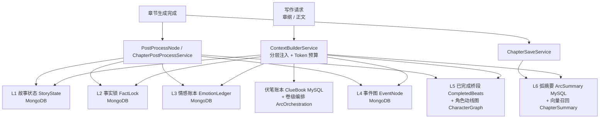
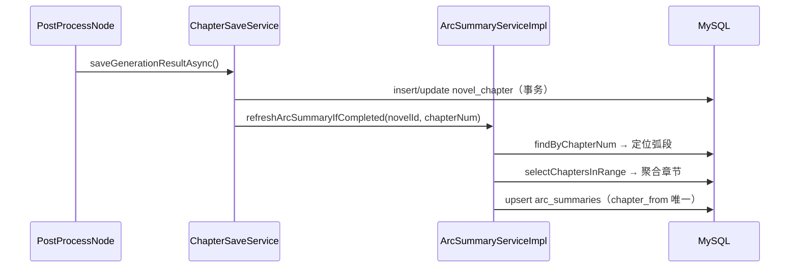
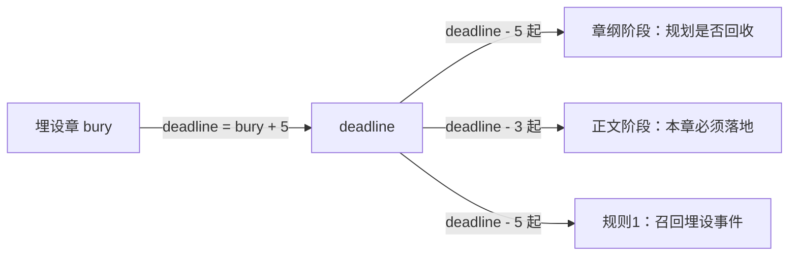

# 04 长程记忆子系统

> 本文描述 MoLan **当前实现态**的长程记忆设计：长篇（几十万字）创作过程中，系统如何分层保存「设定 / 人物 / 伏笔 / 事件 / 节拍」，并在每次生成章纲与正文时按需取用。
> 全文论断均给出仓库内证据（`路径:行号`），未实现的推测性能力一律不写入。

---

## 1. 问题定义：为什么不能「把前文全塞进 prompt」

长篇创作的难点不是「让模型写得像小说」，而是**在第 200 章时还记得第 3 章发生过什么**。把前 200 章正文一次性拼进 prompt 的做法有四个硬伤：

| 硬伤 | 具体表现 | 本仓库的应对 |
| --- | --- | --- |
| 上下文预算线性增长 | 几十万字远超模型上下文上限 | 按章节聚合的**弧摘要**（`backend/src/main/java/com/novel/system/service/memory/ArcSummaryServiceImpl.java:36`，上限 1000 字/弧）+ 按优先级分层的预算截断（`backend/src/main/java/com/novel/system/service/chapter/TokenBudgetService.java:46`） |
| 关键约束被稀释 | 几十万字里「主角已死」「禁止复活」淹没在正文里 | 事实锁单独成层并全量注入（`backend/src/main/java/com/novel/system/service/memory/FactLockServiceImpl.java:37`） |
| 无差别注入 = 无检索 | 每章都付同样的 token 成本 | 事件图 + 规则驱动检索按触发条件召回（`backend/src/main/java/com/novel/system/service/event/RuleDrivenRetrievalService.java:20`） |
| 写完无法自查 | 模型不会主动检查自己是否违反既有设定 | 生成后的事实锁一致性校验节点（`backend/src/main/java/com/novel/system/ai/graph/FactLockViolationNode.java:45`） |

代码作者在 `ContextBuilderService` 的类注释中给出了同一思路：按层存储、按条件注入、Token 预算动态分配
（`backend/src/main/java/com/novel/system/service/chapter/ContextBuilderService.java:33`）。

---

## 2. 六层记忆架构

> 说明：代码内部注释使用「五层记忆架构 + 第六层 RAG」的编号（`backend/src/main/java/com/novel/system/service/chapter/ContextBuilderService.java:33`）。
> 本文的「六层」是**按存储形态**重新归并的视角，便于逐层说明「存什么 / 存在哪 / 谁写 / 谁读」，层与层之间与代码一一对应。

### 2.1 逐层说明

| 层 | 存什么 | 存储位置 | 写入方 | 读取方 / 消费点 |
| --- | --- | --- | --- | --- |
| **L1 结构化记忆（故事状态）** | 时间线、主角状态（位置/实力/物品/目标）、场景上下文、节奏状态、近 10 条重大事件、叙事标记（悬念/揭露/校验警告）、收束状态、压缩背景 | MongoDB `story_state`（`backend/src/main/java/com/novel/system/entity/mongo/StoryState.java:19`） | `StoryStateServiceImpl.updateAfterChapter`（`backend/src/main/java/com/novel/system/service/story/StoryStateServiceImpl.java:46`），由 `ChapterSaveService.saveToMongoAsync` 调用（`backend/src/main/java/com/novel/system/service/chapter/ChapterSaveService.java:179`） | `ContextBuilderService` 章纲上下文 `:213`、正文上下文 `:528`；`formatForPrompt` 输出「【当前故事状态】」（`backend/src/main/java/com/novel/system/service/story/StoryStateServiceImpl.java:327`） |
| **L2 事实锁** | 已知角色、已故角色（含死因与章号）、关系锁定、时间线锚点、世界观硬规则 | MongoDB `fact_lock`（`backend/src/main/java/com/novel/system/entity/mongo/FactLock.java:13`） | `FactLockServiceImpl.updateAfterChapter`，LLM 从正文前 3000 字抽取（`backend/src/main/java/com/novel/system/service/memory/FactLockServiceImpl.java:82`），调用点 `backend/src/main/java/com/novel/system/ai/graph/PostProcessNode.java:110` | 注入：`ContextBuilderService:253`（章纲）、`:558`（正文）；校验：`FactLockServiceImpl.detectViolations`（`:157`）被 `FactLockViolationNode` 调用（`backend/src/main/java/com/novel/system/ai/graph/FactLockViolationNode.java:45`） |
| **L3 情感账本** | 每章的「创伤 / 恩惠 / 权力变化 / 未解钩子（带紧急度）」 | MongoDB `emotion_ledger`（`backend/src/main/java/com/novel/system/entity/mongo/EmotionLedger.java:14`） | `EmotionLedgerServiceImpl.extractFromChapter`（`backend/src/main/java/com/novel/system/service/memory/EmotionLedgerServiceImpl.java:95`），调用点 `backend/src/main/java/com/novel/system/ai/graph/PostProcessNode.java:111` | `ContextBuilderService:143`（章纲）、`:458`（正文）；只输出**近 5 章**（`backend/src/main/java/com/novel/system/service/memory/EmotionLedgerServiceImpl.java:49`） |
| **L4 事件图** | 章节关键事件：类型、参与角色、地点、重要性(1-10)、标签、关联事件 | MongoDB `event_graph`（`backend/src/main/java/com/novel/system/entity/mongo/EventNode.java:20`） | `ChapterPostProcessService.extractEvents`：LLM 抽取 + 程序化对话抽取，合并后 `eventGraphService.saveAll`（`backend/src/main/java/com/novel/system/service/chapter/ChapterPostProcessService.java:623`） | 规则驱动召回（见 §3.3）→ `EventGraphService.formatEventsForPrompt`（`backend/src/main/java/com/novel/system/service/event/EventGraphService.java:93`）→ 注入 `ContextBuilderService:159`、`:474` |
| **L5 已完成桥段 + 角色动线图** | 已完成且不可逆的剧情节拍（摘要/角色/所属剧情线）；角色档案（核心特质、当前状态、关系映射、禁止行为）与人物关系图谱节点/边 | MongoDB `completed_beats`、`character_state`、`novel_graph`（`backend/src/main/java/com/novel/system/entity/mongo/CompletedBeats.java:14`、`CharacterState.java:19`、`NovelGraph.java:13`） | `CompletedBeatsServiceImpl.extractFromChapter`（`backend/src/main/java/com/novel/system/service/memory/CompletedBeatsServiceImpl.java:65`，调用点 `PostProcessNode.java:112`）；人物由 `ChapterPostProcessService.extractCharacters` 写（`backend/src/main/java/com/novel/system/service/chapter/ChapterPostProcessService.java:160`） | 桥段注入 `ContextBuilderService:263`、`:568`（只保留最近 20 条，`backend/src/main/java/com/novel/system/service/memory/CompletedBeatsServiceImpl.java:50`）；动线图 `CharacterGraphServiceImpl.formatGraphAsString`（`backend/src/main/java/com/novel/system/ai/memory/CharacterGraphServiceImpl.java:153`）注入 `ContextBuilderService:281`、`:653` |
| **L6 弧摘要 + 向量召回** | 弧段（卷）级故事线摘要；每章剧情指纹 + 关键词 + 向量 | MySQL `arc_summaries`（`backend/src/main/java/com/novel/system/entity/mysql/ArcSummary.java:15`）；MongoDB `chapter_summary` + 向量库（`backend/src/main/java/com/novel/system/entity/mongo/ChapterSummary.java:17`） | 弧摘要见 §4；向量摘要 `RagServiceImpl.saveSummary`（`backend/src/main/java/com/novel/system/ai/rag/RagServiceImpl.java:464`），调用点 `backend/src/main/java/com/novel/system/service/chapter/ChapterSaveService.java:162` | 弧摘要注入 `ContextBuilderService:94`（章纲）、`:409`（正文）；向量召回 `ragService.hybridSearch` 注入 `ContextBuilderService:182`、`:497`（实现细节见 05 篇） |

### 2.2 贯穿各层的两类约束源

- **伏笔账本 ClueBook（MySQL）**：不是独立一层，而是被 L4 规则、L6 检索与上下文注入共同消费。其 `deadline` 直接决定「紧急提示」与「规则 1 召回」的触发时机，详见 §5。
- **卷级编排 ArcOrchestration（MongoDB `arc_orchestrations`，`backend/src/main/java/com/novel/system/entity/mongo/ArcOrchestration.java:17`）**：单章节奏标签、叙事视角、伏笔埋收计划，作为硬约束注入 `ContextBuilderService:317`（章纲）、`:612`（正文）。

---

## 3. 写入时机与读取时机

### 3.1 写入时机（谁在什么节点写）

| 写入方 | 触发节点 | 写入内容 | 存储 | 是否阻塞主流程 |
| --- | --- | --- | --- | --- |
| `ChapterSaveService.saveToMySQL` | 章节正文落库时（`post_process` 节点，`backend/src/main/java/com/novel/system/ai/graph/PostProcessNode.java:68`） | 章节正文/章纲/字数/钩子 | MySQL `novel_chapter`（`backend/src/main/java/com/novel/system/entity/mysql/NovelChapter.java:12`） | 是（`@Transactional`，`ChapterSaveService.java:93`） |
| `ArcSummaryServiceImpl.refreshArcSummaryIfCompleted` | 同一事务内、章节写完之后（`backend/src/main/java/com/novel/system/service/chapter/ChapterSaveService.java:148`） | 弧摘要（弧名 + 每章要点） | MySQL `arc_summaries` | 否，异常只 warn（`ChapterSaveService.java:149`） |
| `ChapterSaveService.saveToMongoAsync` | MySQL 提交后异步（`@Async`，`ChapterSaveService.java:157`） | `ChapterSummary`（含向量）、知识图谱边、故事状态 | MongoDB `chapter_summary` / `novel_graph` / `story_state` | 否，各段独立 try/catch |
| `PostProcessNode` 内存提交 | 保存成功后异步 `CompletableFuture.runAsync`（`backend/src/main/java/com/novel/system/ai/graph/PostProcessNode.java:108`） | 事实锁、情感账本、已完成桥段 | MongoDB `fact_lock` / `emotion_ledger` / `completed_beats` | 否 |
| `ChapterPostProcessService.postProcess` | `@Async("postProcessExecutor")`（`backend/src/main/java/com/novel/system/service/chapter/ChapterPostProcessService.java:66`） | 人物档案与关系、伏笔（含自动 deadline）、时间线、事件图、角色台词样本 | MongoDB / MySQL | 否（带幂等键去重，`ChapterPostProcessService.java:78`） |

### 3.2 读取时机（哪个服务在什么阶段读）

| 读取方 | 阶段 | 读取内容 |
| --- | --- | --- |
| `ContextBuilderService.buildOutlineContext` | **章纲生成前**（默认 8192 token 预算，`ContextBuilderService.java:70`） | 弧摘要 → 近 8 章大纲 → 上章钩子与正文结尾 → 情感账本 → 事件图规则召回 → 台词回响 → RAG → 故事状态 → 事实锁 → 已完成桥段 → 角色档案与动线图 → 伏笔账本 → 卷级编排 → 总纲/卷纲/世界观（`ContextBuilderService.java:87` 起） |
| `ContextBuilderService.buildWritingContext` | **正文生成前**（`ContextBuilderService.java:402`） | 与章纲上下文同构，差异见 §5 与下表 |
| `FactLockViolationNode` | 审计 PASS 后（FULL 模式，`backend/src/main/java/com/novel/system/service/chapter/MultiAgentNovelService.java:61`） | 事实锁快照，用于生成后一致性检查 |
| `ValidationNode` / `SelfReviewNode` | 校验与自审阶段（`backend/src/main/java/com/novel/system/ai/graph/ValidationNode.java:118`） | 叙事阶段（phase），用于差异化校验策略 |

两个入口的差异只有三处（其余段落一一对应）：

| 差异点 | `buildOutlineContext` | `buildWritingContext` |
| --- | --- | --- |
| 近章大纲条数 | 8 章（`ContextBuilderService.java:108`） | 5 章（`ContextBuilderService.java:423`） |
| 伏笔紧急窗口 | `chapterNum >= deadline - 5`（`ContextBuilderService.java:299`） | `chapterNum >= deadline - 3`（`ContextBuilderService.java:594`） |
| RAG 查询文本 | 卷纲 `arcOutline`（`ContextBuilderService.java:180`） | 本章章纲 `chapter.getChapterOutline()`（`ContextBuilderService.java:495`） |

### 3.3 规则驱动召回：5 条规则

规则位于 `RuleDrivenRetrievalService`（类注释 `backend/src/main/java/com/novel/system/service/event/RuleDrivenRetrievalService.java:20`），由 `autoRetrieve` 统一调度并按 `eventId` 去重（`:63`）：

| 规则 | 触发条件 | 阈值常量 | 检索内容 |
| --- | --- | --- | --- |
| 规则 1 伏笔回收触发 | `chapterNum >= deadline - CLUE_TRIGGER_DISTANCE` | `CLUE_TRIGGER_DISTANCE = 5`（`:36`） | 伏笔埋设章标记为「伏笔埋设」的事件 + 埋设前后 5 章内相关角色事件（`:102`） |
| 规则 2 角色重逢触发 | 章纲出现「再次/重新/归来/回归/出现/登场/现身」的角色名，且距最后出场 > 阈值 | `CHARACTER_REUNION_THRESHOLD = 20`（`:39`） | 该角色最后出场事件（`:140`） |
| 规则 3 地点关联触发 | 章纲出现「在/来到/到达/进入/回到/身处/位于/前往 + 地名」 | `LOCATION_MIN_IMPORTANCE = 7`（`:42`） | 该地点重要度 ≥7 的历史事件，排除近 5 章（`:162`） |
| 规则 4 近期重要事件 | 近 10 章 | `RECENT_CHAPTER_RANGE = 10`、`RECENT_MIN_IMPORTANCE = 8`（`:45`、`:48`） | 重要性 ≥8 的事件（`:183`） |
| 规则 5 经典台词召回 | 章纲文本中出现已登记角色名 | `MIN_AGE_CHAPTERS = 15`、`MAX_RESULTS = 2`（`backend/src/main/java/com/novel/system/service/memory/EchoRecallServiceImpl.java:26`） | 该角色 15 章前的代表性台词（`RuleDrivenRetrievalService.java:194`） |

规则 5 产出的文本在 `ContextBuilderService` 中单独注入（`:169`、`:484`），与事件召回分开截断（800 token 上限）。

---

## 4. 弧摘要的幂等写入

### 4.1 写入流程

`ArcSummaryServiceImpl.refreshArcSummaryIfCompleted`（`backend/src/main/java/com/novel/system/service/memory/ArcSummaryServiceImpl.java:42`）在章节落库后被同步调用（`backend/src/main/java/com/novel/system/service/chapter/ChapterSaveService.java:148`），步骤为：

1. **定位弧段**：`novelArcMapper.findByChapterNum` 按 `chapterNum BETWEEN start_chapter AND COALESCE(end_chapter, 999999)` 命中卷（`backend/src/main/resources/mapper/NovelArcMapper.xml:28`）；找不到则跳过。
2. **确定弧段终点**：配置了 `end_chapter` 时，未写到该章不生成（`ArcSummaryServiceImpl.java:62`）；未配置（开放弧段）则取当前最大章节号，每写一章刷新一次（`:71`）。
3. **聚合章节要点**：从 MySQL `novel_chapter` 取区间闭区间内的章节（`backend/src/main/java/com/novel/system/mapper/NovelChapterMapper.java:46`），每章一行「第N章《标题》：要点」。
4. **单章要点取数优先级**：章摘要 → 剧情指纹 → 章纲 → 正文开头，单条截断 80 字（`ArcSummaryServiceImpl.java:125`）；整段摘要上限 1000 字（`:36`）。
5. **Upsert**：以 `(novel_id, chapter_from)` 作为弧段唯一标识，先查后写；命中则更新 `chapter_to` + `summary`，否则插入新行（`ArcSummaryServiceImpl.java:165`）。

### 4.2 为什么用 `(novel_id, chapter_from)` 做唯一标识

- 一个弧段（卷）对应连续的章节区间 `[start_chapter, end_chapter]`，**起始章节号天然唯一标识这个弧段**（`backend/src/main/java/com/novel/system/entity/mysql/NovelArc.java:22`）。
- 开放弧段每写一章都要刷新摘要，若以「章号」为标识会每章新增一行，弧摘要表会退化成逐章摘要，违背「弧级压缩」的初衷；用起始章号则始终只有一行，覆盖更新。
- `arc_summaries` 表没有唯一键，因此实现上用「先查后写」保证幂等，不会产生重复行（`ArcSummaryServiceImpl.java:161` 注释与 `:165` 实现）；表无 `update_time` 字段，刷新时同步刷新 `create_time`（`:177`）。

### 4.3 为什么不用 MongoDB 的 `chapter_summary` 作为弧摘要来源

| 维度 | MySQL `arc_summaries`（现用） | MongoDB `chapter_summary`（未采用） |
| --- | --- | --- |
| 表达的能力 | 带 `chapterFrom` / `chapterTo` 的**区间**语义（`backend/src/main/java/com/novel/system/entity/mysql/ArcSummary.java:32`） | 逐章文档，无卷/弧边界（`backend/src/main/java/com/novel/system/entity/mongo/ChapterSummary.java:21`） |
| 数据可靠性 | 来源是 MySQL `novel_chapter`，章节正文/标题/章纲**一定在库里**（`ArcSummaryServiceImpl.java:21` 注释） | 写入依赖 `RagServiceImpl.saveSummary`，且在异步阶段执行；向量化失败会跳过向量（`backend/src/main/java/com/novel/system/ai/rag/RagServiceImpl.java:488`） |
| 与 RAG 的关系 | 无耦合 | 正是第六层向量召回的数据源，被语义检索与 rerank 复用，二者若共用会互相污染 |
| 触发时机 | 章节落库事务内同步完成，弧写完即有摘要 | 异步 + 与嵌入模型可用性相关，时序不稳定 |

结论：弧摘要承担的是「**结构化的、可确定生成**」的记忆，必须来自最稳的关系型章节表；Mongo 的 `chapter_summary` 承担的是「**语义可检索**」的记忆，二者职责分离。

---

## 5. 伏笔 deadline 参与上下文分层

### 5.1 deadline 的产生

- 默认回收期限：`DEFAULT_DEADLINE_CHAPTERS = 5`，即 `deadline = 埋设章节 + 5`
  （`backend/src/main/java/com/novel/system/service/clue/ClueBookServiceImpl.java:33`，实现 `resolveDeadline` 在 `:57`）。
- 用户建伏笔未指定 deadline 时，后端自动补默认值（`ClueBookServiceImpl.java:44`）。
- LLM 自动抽取的伏笔同样带上 deadline（`backend/src/main/java/com/novel/system/service/chapter/ChapterPostProcessService.java:512`），
  以保证「紧急提示」与「规则 1 召回」对所有伏笔都生效。

### 5.2 三个消费窗口（同一 deadline，三种灵敏度）

| 消费点 | 判定 | 行为 | 证据 |
| --- | --- | --- | --- |
| 章纲上下文 | `chapterNum >= deadline - 5` | 标注「⚠️【紧急】建议 X 章前回收（已临近）」，供**规划**阶段提前安排 | `backend/src/main/java/com/novel/system/service/chapter/ContextBuilderService.java:299` |
| 正文上下文 | `chapterNum >= deadline - 3` | 标注「⚠️【紧急】建议本章回收（已临近deadline）」，要求**本章落地** | `backend/src/main/java/com/novel/system/service/chapter/ContextBuilderService.java:594` |
| 事件图规则 1 | `chapterNum >= deadline - 5` | 触发伏笔埋设事件的图谱召回，把「当初怎么埋的」放进上下文 | `backend/src/main/java/com/novel/system/service/event/RuleDrivenRetrievalService.java:110`（常量 `CLUE_TRIGGER_DISTANCE = 5`，`:36`） |

### 5.3 为什么要分层

- **规划宽、执行严**：章纲阶段提前 5 章提醒，是为了让写作者**安排**回收时机；正文阶段收紧到 3 章，是因为正文已无调整空间，必须在本章收掉，否则伏笔烂尾。
- **与默认期限自洽**：`DEFAULT_DEADLINE_CHAPTERS = 5` 恰好等于最宽窗口，因此伏笔在埋设当章即进入 `deadline-5` 窗口（规则 1 从埋设章起就能召回埋设事件），埋设后第 3 章起进入 `deadline-3` 窗口（正文开始提示紧急）——这条口径写在 `ClueBookServiceImpl.java:29` 的注释里。
- **两处提示文案不同**：章纲说「建议 X 章前回收（已临近）」，正文说「建议本章回收（已临近deadline）」，措辞与阶段职责对应（`ContextBuilderService.java:300` 与 `:595`）。
- **空值保护**：手动创建的伏笔可能没有埋设章节，注入时做了空值判断，避免自动拆箱 NPE（`ContextBuilderService.java:304`、`:599`）。

---

## 6. 边界与降级

### 6.1 向量层（第六层）未配置嵌入模型时的行为

| 环节 | 行为 | 证据 |
| --- | --- | --- |
| 取模型 | 找不到 `usageType=embedding` 的活跃配置时回退到 `all`；都没有则返回 `null` 并 warn | `backend/src/main/java/com/novel/system/ai/rag/EmbeddingService.java:194` |
| 生成向量 | 模型为 `null` 时 `embed` 抛 `IllegalStateException`，提示需在模型管理中配置 embedding | `backend/src/main/java/com/novel/system/ai/rag/EmbeddingService.java:47` |
| 向量检索 | 异常被捕获，`vectorSearch` 返回空列表，**不抛错** | `backend/src/main/java/com/novel/system/ai/rag/RagServiceImpl.java:166` |
| 混合检索 | 向量分支为空时，BM25/关键词分支仍可返回结果，整层继续产出内容 | `backend/src/main/java/com/novel/system/ai/rag/RagServiceImpl.java:245` |
| 写入侧 | 向量化失败只跳过向量，摘要仍写入 MongoDB | `backend/src/main/java/com/novel/system/ai/rag/RagServiceImpl.java:488` |
| 主流程 | 上下文构建中的 RAG 调用被 try/catch 包裹，失败只 warn「不影响生成」 | `backend/src/main/java/com/novel/system/service/chapter/ContextBuilderService.java:196`、`:511` |

即：**向量层是「有则增强、无则跳过」的增强项，缺失不影响章节生成**；此时长程一致性仍由 L1–L6 的结构化记忆承担。

### 6.2 记忆层的整体降级原则

- 上下文中**每一段记忆独立 try/catch**，任何一段读取异常都只记录日志、不阻断生成
  （`backend/src/main/java/com/novel/system/service/chapter/ContextBuilderService.java:142`、`:151`、`:178`、`:252`、`:262` 等）。
- 写入侧同理：事实锁/情感账本/桥段抽取失败只 log（`backend/src/main/java/com/novel/system/service/memory/FactLockServiceImpl.java:151`），
  弧摘要失败不影响章节保存（`backend/src/main/java/com/novel/system/service/chapter/ChapterSaveService.java:149`）。
- **Token 不足时的取舍是显式规则**：按 T0（永不压缩：故事状态、伏笔账本、角色档案）/ T1（可压缩：弧摘要、总纲、世界观、情感账本）/ T2（按水位线截断：近章大纲）/ T3（最先牺牲：台词回响）分层分配预算
  （`backend/src/main/java/com/novel/system/service/chapter/TokenBudgetService.java:26`、`:63`），输出空间按 39% 比例预留（`:56`）。

### 6.3 已写入但消费路径较弱的环节（如实记录）

| 环节 | 现象 | 代码佐证 |
| --- | --- | --- |
| 收束状态（Convergence） | `updateConvergenceState` 在全仓**没有任何调用方**，`convergenceState` 字段实际不会被写入；读取时因 `cs == null` 直接返回空串，`getPhase` 恒返回兜底值 `DEVELOPMENT` | `backend/src/main/java/com/novel/system/service/memory/ConvergenceServiceImpl.java:52`（定义）、`:21`（空串返回）、`:76`（兜底）；调用方只有 `ValidationNode`/`SelfReviewNode` 的 `getPhase` |
| 人物关系图谱的「关系」部分 | `novel_graph` 的边由章节保存路径写入时只设置 `relation` 与 `lastUpdateChapter`，**未设置 `relationType`**；而图谱格式化时 `relationType` 为空即跳过该边，因此自动生成的边不会出现在注入文本里，注入的实际只有「主要人物」列表 | 写入 `backend/src/main/java/com/novel/system/service/chapter/ChapterSaveService.java:248`；过滤 `backend/src/main/java/com/novel/system/ai/memory/CharacterGraphServiceImpl.java:235`；输出 `backend/src/main/java/com/novel/system/ai/memory/CharacterGraphServiceImpl.java:163`。会写入 `relationType` 的 `addRelationship` 目前只有 REST 入口调用（`backend/src/main/java/com/novel/system/controller/CharacterGraphController.java:27`） |
| 章节级记忆压缩接口 | `RagService.compressMemory` 已实现但**全仓无调用方**，因此不构成生效链路；真正生效的全局背景压缩是 `StoryStateServiceImpl` 每 20 章一次的 `compressBackstory` | `backend/src/main/java/com/novel/system/ai/rag/RagServiceImpl.java:498`（实现）、`backend/src/main/java/com/novel/system/ai/rag/RagService.java:58`（接口）；实际生效路径 `backend/src/main/java/com/novel/system/service/story/StoryStateServiceImpl.java:88`（触发）、`:235`（实现） |
| 事实锁的生成后校验 | 校验只在 FULL 模式、且审计节点判定 PASS 后进入；FAST 模式直接跳过 | `backend/src/main/java/com/novel/system/ai/graph/FactLockViolationNode.java:25`、`backend/src/main/java/com/novel/system/service/chapter/MultiAgentNovelService.java:61` |
| 情感账本 / 已完成桥段的读取窗口 | 情感账本只输出近 5 章，桥段只输出最近 20 条，属于刻意设定的读取窗口而非全量记忆 | `backend/src/main/java/com/novel/system/service/memory/EmotionLedgerServiceImpl.java:49`、`backend/src/main/java/com/novel/system/service/memory/CompletedBeatsServiceImpl.java:50` |

### 6.4 与其它文档的衔接

- 第六层的向量召回（`ChapterSummary` + 向量库 + 混合检索 + rerank）实现细节见 **05 篇（RAG 检索子系统）**；本文只覆盖它在记忆体系中的定位：写入时机、注入位置与降级行为。
- 图编排节点顺序（`arc_check → outline → writing → self_review → continuity_validation → validation → quality_scoring → audit_router → fact_lock_violation → summary → post_process`）见 **02 篇（图编排引擎）**；本文 §3.1、§3.2 的时序以该编排为前提。

---

*本文档描述的是仓库当前代码的实现状态。若某处行为与文档描述不符，以代码为准。*
