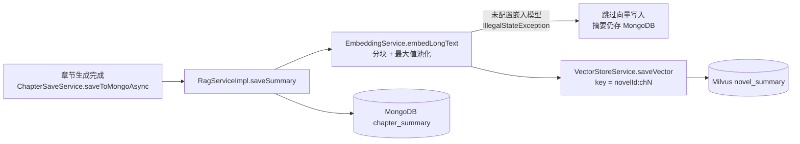

# 05 RAG 与向量检索

> 本文描述 MoLan **当前实现态**的向量检索链路：一条**可选的增强链路**，用于在生成章纲/正文时召回「更早、更冷」的章节剧情。
> 全文论断均给出仓库内证据（`相对仓库根的路径:行号`），未实现的推测性能力一律不写入；线上运行态与代码期望不一致的地方集中在第 8 节「当前边界」，如实记录。

---

## 1. 定位：增强链路，不是生成的必经环节

| 维度 | 生成链路（必经） | 向量检索链路（可选） |
| --- | --- | --- |
| 触发时机 | 每章生成 | 每章生成时**附带**执行一次检索 |
| 失败影响 | 生成失败 | **不影响生成**：`ContextBuilderService` 把 RAG 段落整体包在 `try/catch` 中，日志为「RAG 自动检索失败（不影响生成）」（`backend/src/main/java/com/novel/system/service/chapter/ContextBuilderService.java:197`、`backend/src/main/java/com/novel/system/service/chapter/ContextBuilderService.java:512`） |
| 数据前提 | 无 | 需要用户配置可用的**嵌入（embedding）模型**并写入向量库 |

因此本文反复强调的一点：**「写了 RAG 代码」≠「检索一定召回」**。向量库是否为空，取决于运行环境中是否配置了嵌入模型（详见 §8.1）。

---

## 2. 抽象层：`VectorStoreService`

### 2.1 为什么要接口化

早期实现的向量存储直接绑定 **Redis Stack**（用 `FT.CREATE` 建 VECTOR 索引、`FT.SEARCH ... KNN` 做近似最近邻、`JSON.SET` 存文档）。该路线把「存储介质」与「检索逻辑」耦合在一起，无法在不重写上层的前提下更换引擎。

现在的做法是：

1. 抽出与引擎无关的接口，Javadoc 明确「不绑定具体存储实现（Redis Stack / Milvus / Qdrant 等）」（`backend/src/main/java/com/novel/system/ai/rag/VectorStoreService.java:8`）；
2. 以 Milvus 实现落地，并删除 Redis 版实现。git 记录可佐证这条演进线：`6b96b6a`（新增接口，替换 Redis 实现）→ `3264784`（新增 Milvus 实现 + HNSW/COSINE 索引 + 数据迁移）→ `9e6897a`（移除 `RedisVectorService` / `RedisVectorServiceImpl` / `RedisVectorConfig`）。

### 2.2 接口方法清单

| 方法 | 签名 | 语义 | 定义位置 |
| --- | --- | --- | --- |
| `ensureCollection()` | `void` | 确保集合/索引存在，**幂等**，启动时调用 | `backend/src/main/java/com/novel/system/ai/rag/VectorStoreService.java:15` |
| `dropCollection()` | `void` | 删除集合/索引 | `backend/src/main/java/com/novel/system/ai/rag/VectorStoreService.java:20` |
| `saveVector(key, vector, metadata)` | `void` | 写入一条向量 + 元数据 | `backend/src/main/java/com/novel/system/ai/rag/VectorStoreService.java:28` |
| `search(queryVector, topK, filter)` | `List<VectorSearchResult>` | 向量相似度检索 | `backend/src/main/java/com/novel/system/ai/rag/VectorStoreService.java:37` |
| `deleteVector(key)` | `void` | 按 key 删除向量 | `backend/src/main/java/com/novel/system/ai/rag/VectorStoreService.java:43` |
| 内部类 `VectorSearchResult` | `key / score / metadata` | 检索结果载体 | `backend/src/main/java/com/novel/system/ai/rag/VectorStoreService.java:48` |

`filter` 的格式由实现层自定义：`MilvusVectorStoreServiceImpl` 支持 `@novelId:{xxx}` 形式的伪 DSL，转换为 Milvus 布尔表达式 `novelId == "xxx"`，并对 novelId 做白名单正则校验防注入（`backend/src/main/java/com/novel/system/ai/rag/MilvusVectorStoreServiceImpl.java:348`）。

---

## 3. Milvus 集合 Schema

集合名由配置 `milvus.collection-name` 决定，代码默认 `novel_summary`（`backend/src/main/java/com/novel/system/config/MilvusVectorConfig.java:28`、`backend/src/main/resources/application.yml:94`）。

### 3.1 字段定义

| 字段 | 类型 | 约束 | 建表代码 |
| --- | --- | --- | --- |
| `id` | VarChar(256) | 主键，`autoID=false` | `backend/src/main/java/com/novel/system/ai/rag/MilvusVectorStoreServiceImpl.java:127` |
| `novelId` | VarChar(128) | **Partition Key**（按小说隔离） | `backend/src/main/java/com/novel/system/ai/rag/MilvusVectorStoreServiceImpl.java:136` |
| `chapterNum` | Int64 | 章节号 | `backend/src/main/java/com/novel/system/ai/rag/MilvusVectorStoreServiceImpl.java:144` |
| `content` | VarChar(65535) | 章节摘要正文 | `backend/src/main/java/com/novel/system/ai/rag/MilvusVectorStoreServiceImpl.java:150` |
| `keywords` | VarChar(1024) | 关键词（逗号分隔） | `backend/src/main/java/com/novel/system/ai/rag/MilvusVectorStoreServiceImpl.java:157` |
| `priority` | Int64 | 优先级（写入时默认 3） | `backend/src/main/java/com/novel/system/ai/rag/MilvusVectorStoreServiceImpl.java:164` |
| `embedding` | FloatVector | 维度 = `config.getDimension()`，默认 **1024** | `backend/src/main/java/com/novel/system/ai/rag/MilvusVectorStoreServiceImpl.java:170`、`backend/src/main/java/com/novel/system/config/MilvusVectorConfig.java:31` |

`novelId` 设为 Partition Key 的效果是：检索时用 `novelId == "..."` 过滤即可天然限定在**单本小说**内，多个小说共用一张集合而互不串味。

### 3.2 索引与加载

| 参数 | 取值 | 来源 |
| --- | --- | --- |
| 索引类型 | `HNSW` | `backend/src/main/java/com/novel/system/ai/rag/MilvusVectorStoreServiceImpl.java:182` |
| 度量 | `COSINE` | `backend/src/main/java/com/novel/system/ai/rag/MilvusVectorStoreServiceImpl.java:183` |
| `M` | 16 | `backend/src/main/java/com/novel/system/ai/rag/MilvusVectorStoreServiceImpl.java:177`、`backend/src/main/java/com/novel/system/config/MilvusVectorConfig.java:39` |
| `efConstruction` | 256 | `backend/src/main/java/com/novel/system/ai/rag/MilvusVectorStoreServiceImpl.java:178`、`backend/src/main/java/com/novel/system/config/MilvusVectorConfig.java:42` |
| `numShards` | 1 | `backend/src/main/java/com/novel/system/ai/rag/MilvusVectorStoreServiceImpl.java:192` |
| 检索 `ef` | `max(topK*2, 64)` | `backend/src/main/java/com/novel/system/ai/rag/MilvusVectorStoreServiceImpl.java:281` |

集合创建后立即 `loadCollection` 载入内存（`backend/src/main/java/com/novel/system/ai/rag/MilvusVectorStoreServiceImpl.java:199`）；`ensureCollection` 整体幂等——集合已存在则直接走迁移检查后返回（`backend/src/main/java/com/novel/system/ai/rag/MilvusVectorStoreServiceImpl.java:115`）。

### 3.3 相关配置键（仅列键名）

| 键名 | 用途 |
| --- | --- |
| `milvus.uri` / `milvus.username` / `milvus.password` / `milvus.database` | 连接与鉴权（值由环境变量注入） |
| `milvus.collection-name` / `milvus.dimension` / `milvus.metric-type` | 集合与向量规格 |
| `milvus.hnsw-m` / `milvus.hnsw-ef-construction` | HNSW 索引参数 |
| `milvus.connect-timeout-ms` / `milvus.keep-alive-time-ms` / `milvus.max-idle-connections` / `milvus.max-connection-pool-size` | 连接池 |
| `embedding.max-input-chars` | 单块文本最大字符数，默认 2000（`backend/src/main/resources/application.yml:106`、`backend/src/main/java/com/novel/system/ai/rag/EmbeddingService.java:32`） |

配置绑定类为 `MilvusVectorConfig`（`@ConfigurationProperties(prefix = "milvus")`，`backend/src/main/java/com/novel/system/config/MilvusVectorConfig.java:12`）。

---

## 4. 相似度语义（最易写错的一节）

**Milvus 在 `metricType=COSINE` 下返回的 score 本身就是余弦相似度，不是距离。** 代码中直接取用，不做任何换算：

```java
// backend/src/main/java/com/novel/system/ai/rag/MilvusVectorStoreServiceImpl.java:301-304
// Milvus 在 metricType=COSINE 下返回的 score 已是余弦相似度（范围 [-1, 1]，
// 完全相同为 1.0、正交为 0.0、完全相反为 -1.0），不可再按距离做 1-score 换算，
// 否则最相关的结果会被反向过滤。
double similarity = result.getScore();
```

检索请求侧同样显式指定 `COSINE`（`backend/src/main/java/com/novel/system/ai/rag/MilvusVectorStoreServiceImpl.java:288`）。

| score 取值 | 语义 |
| --- | --- |
| 1.0 | 两向量完全相同（最相关） |
| 0.0 | 正交 |
| -1.0 | 完全相反 |
| `< 0.3` | 低于阈值，被检索层丢弃（`backend/src/main/java/com/novel/system/ai/rag/RagServiceImpl.java:45`、`backend/src/main/java/com/novel/system/ai/rag/RagServiceImpl.java:152`） |

> 历史教训：早期实现写的是 `similarity = 1.0 - score`（把 score 当距离），导致**最相关的结果被反向过滤**。该问题由提交 `8b862d9`（`fix(rag): 修正 Milvus COSINE 相似度换算导致的相关性反向过滤`）修正为上文的直接取值，并补上了注释。

---

## 5. 写入侧

### 5.1 章节摘要 → 嵌入 → 写库



| 步骤 | 说明 | 证据 |
| --- | --- | --- |
| 调用入口 | `ChapterSaveService.saveToMongoAsync`（`@Async`）调用 `ragService.saveSummary(summary)`，外层 `try/catch` 保证不影响章节保存 | `backend/src/main/java/com/novel/system/service/chapter/ChapterSaveService.java:157`、`backend/src/main/java/com/novel/system/service/chapter/ChapterSaveService.java:162` |
| 生成嵌入 | `embeddingService.embedLongText(summary.getContent())`；长文本按段落/句号切块后**逐维取最大值池化** | `backend/src/main/java/com/novel/system/ai/rag/RagServiceImpl.java:474`、`backend/src/main/java/com/novel/system/ai/rag/EmbeddingService.java:74` |
| 元数据组装 | `novelId / chapterNum / content / keywords / priority`，key = `novelId + ":ch" + chapterNum` | `backend/src/main/java/com/novel/system/ai/rag/RagServiceImpl.java:476`、`backend/src/main/java/com/novel/system/ai/rag/RagServiceImpl.java:483` |
| 落库 | `saveVector` 先按 key 删除再插入，实现 **upsert 语义** | `backend/src/main/java/com/novel/system/ai/rag/MilvusVectorStoreServiceImpl.java:234` |
| 失败处理 | 向量化异常被捕获并记日志，**摘要仍写入 MongoDB** | `backend/src/main/java/com/novel/system/ai/rag/RagServiceImpl.java:488` |

嵌入模型实例由 `LangChainConfig.createEmbeddingModel` 构建并带缓存（`backend/src/main/java/com/novel/system/config/LangChainConfig.java:165`），底层走 OpenAI 兼容的 embeddings 接口，模型名优先取配置里的 `embeddingModel` 字段，其次 `modelName`（`backend/src/main/java/com/novel/system/config/LangChainConfig.java:313`）。

### 5.2 嵌入模型的选择顺序

`EmbeddingService.getEmbeddingModel()` 的策略（`backend/src/main/java/com/novel/system/ai/rag/EmbeddingService.java:194`）：

| 优先级 | 查找方式 | 证据 |
| --- | --- | --- |
| 1 | `usageType=embedding` 的活跃模型配置 | `backend/src/main/java/com/novel/system/ai/rag/EmbeddingService.java:197` |
| 2 | 回退到 `usageType=all` 的活跃配置（会打 WARN 提示这是聊天模型配置） | `backend/src/main/java/com/novel/system/ai/rag/EmbeddingService.java:203` |
| 3 | 再回退到任意一条活跃配置；仍无则返回 `null` | `backend/src/main/java/com/novel/system/service/llm/LlmConfigServiceImpl.java:82` |

**LLM 与嵌入配置在数据库中是同一张 `llm_config` 表**（`backend/src/main/java/com/novel/system/entity/mysql/LlmConfig.java:12`），靠 `usageType` 字段区分用途（默认 `all`，`backend/src/main/java/com/novel/system/entity/mysql/LlmConfig.java:35`），检索时按用途查活跃记录（`backend/src/main/java/com/novel/system/service/llm/LlmConfigService.java:51`）。

### 5.3 未配置嵌入模型时的行为

`embed()` 在拿不到模型时抛出 `IllegalStateException("未配置Embedding模型，请在模型管理中添加 usageType=embedding 的配置")`（`backend/src/main/java/com/novel/system/ai/rag/EmbeddingService.java:50`）。该异常被 `saveSummary` 的 `catch (Exception e)` 吞掉（`backend/src/main/java/com/novel/system/ai/rag/RagServiceImpl.java:488`），结果是：

- 章节摘要**照常**写入 MongoDB；
- 向量**不写入**，集合保持为空；
- 检索时向量支路返回空列表，关键词支路仍可工作（§6）。

### 5.4 历史数据迁移（MongoDB → Milvus）

`ensureCollection` 在「集合已存在」（`:117`）与「新建集合」（`:204`）两处都会调用 `migrateFromMongoDbIfNeeded`（`backend/src/main/java/com/novel/system/ai/rag/MilvusVectorStoreServiceImpl.java:365`）：

| 步骤 | 行为 | 证据 |
| --- | --- | --- |
| 判重 | 先 `query` 一条数据，集合非空则跳过迁移 | `backend/src/main/java/com/novel/system/ai/rag/MilvusVectorStoreServiceImpl.java:376` |
| 读取源 | `mongoTemplate.findAll(ChapterSummary.class)` 拉取全部摘要文档 | `backend/src/main/java/com/novel/system/ai/rag/MilvusVectorStoreServiceImpl.java:384` |
| 跳过无向量 | `embedding` 为空的历史文档被计数跳过 | `backend/src/main/java/com/novel/system/ai/rag/MilvusVectorStoreServiceImpl.java:393` |
| 分批写入 | 每 100 条一次 `insert` | `backend/src/main/java/com/novel/system/ai/rag/MilvusVectorStoreServiceImpl.java:388`、`backend/src/main/java/com/novel/system/ai/rag/MilvusVectorStoreServiceImpl.java:438` |

注意：当前写入路径**只往 Milvus 写，不再冗余存 MongoDB 的 embedding 字段**（`backend/src/main/java/com/novel/system/ai/rag/RagServiceImpl.java:471`），因此该迁移通道实际上只对**早期存量文档**有效。

---

## 6. 查询侧：混合检索与融合排序

```mermaid
graph TD
    Q[查询文本] --> P1[vectorSearch<br/>topK*2]
    Q --> P2[bm25Search<br/>topK*2]
    P1 --> T1[阈值过滤 score >= 0.3]
    P2 --> T2[keywords $in 精确匹配<br/>+ content 正则补齐]
    T1 --> F[RRF 融合<br/>1/(60+rank)]
    T2 --> F
    F --> R[Rerank<br/>LLM 打分 / bigram 回退]
    R --> O[topK 摘要]
```

| 环节 | 实现要点 | 证据 |
| --- | --- | --- |
| 并行召回 | 向量与关键词两路用 `CompletableFuture` + `ioTaskExecutor` 并行执行 | `backend/src/main/java/com/novel/system/ai/rag/RagServiceImpl.java:243` |
| 向量支路 | 查询文本 → 嵌入 → `search(vector, topK*2, "@novelId:{...}")` → 按阈值过滤 → 用 `chapterNum` 回查 MongoDB 取摘要正文 | `backend/src/main/java/com/novel/system/ai/rag/RagServiceImpl.java:133`、`backend/src/main/java/com/novel/system/ai/rag/RagServiceImpl.java:152` |
| 关键词支路 | 方法名为 `bm25Search`，但**实现不是 BM25 打分**：先按中文标点/空格切词（长度 ≥2）后走 `keywords` 字段 `$in` 精确匹配；不足 topK 时再用 `content` 前 30 字符做正则补齐 | `backend/src/main/java/com/novel/system/ai/rag/RagServiceImpl.java:173`、`backend/src/main/java/com/novel/system/ai/rag/RagServiceImpl.java:183`、`backend/src/main/java/com/novel/system/ai/rag/RagServiceImpl.java:197` |
| 融合排序 | RRF（Reciprocal Rank Fusion），`K=60`，得分 `1/(60+rank)`，两路相加 | `backend/src/main/java/com/novel/system/ai/rag/RagServiceImpl.java:43`、`backend/src/main/java/com/novel/system/ai/rag/RagServiceImpl.java:252` |
| 重排序 | 候选数 > topK 时才重排：先试 LLM 打分（`llmService.rerank`），失败回退 **bigram 词法重排**（字符二元组重叠率 + 关键词加分 + 优先级加权） | `backend/src/main/java/com/novel/system/ai/rag/RagServiceImpl.java:296`、`backend/src/main/java/com/novel/system/ai/rag/RagServiceImpl.java:337`、`backend/src/main/java/com/novel/system/ai/rag/RagServiceImpl.java:392` |

### 6.1 上下文注入点

| 模式 | 触发点 | 查询文本 | 证据 |
| --- | --- | --- | --- |
| Push（自动注入） | 章纲上下文构建 | 当前卷纲 | `backend/src/main/java/com/novel/system/service/chapter/ContextBuilderService.java:182` |
| Push（自动注入） | 正文上下文构建 | 本章大纲 | `backend/src/main/java/com/novel/system/service/chapter/ContextBuilderService.java:497` |
| Pull（按需调用） | Agent 工具 `recallHistory` | 工具入参 | `backend/src/main/java/com/novel/system/ai/tool/RagTool.java:53` |
| Pull（按需调用） | MCP 工具 `moyun_recall_history` | 工具入参 | `backend/src/main/java/com/novel/system/mcp/server/tool/RagMcpTools.java:46` |

注入时每条摘要正文截断到 200 字（Push 路径），Pull 路径截断到 300 字。

---

## 7. 降级策略

向量链路的设计原则是：**任何故障都不允许把整个生成流程带崩**。

| 故障场景 | 行为 | 证据 |
| --- | --- | --- |
| Milvus 连接失败（启动时） | 置 `degraded=true`（`backend/src/main/java/com/novel/system/ai/rag/MilvusVectorStoreServiceImpl.java:73`），打印「Milvus 连接失败，向量检索将不可用」（`backend/src/main/java/com/novel/system/ai/rag/MilvusVectorStoreServiceImpl.java:74`），服务照常启动 | `backend/src/main/java/com/novel/system/ai/rag/MilvusVectorStoreServiceImpl.java:72` |
| 降级期间收到检索请求 | 直接返回**空列表**，不抛异常 | `backend/src/main/java/com/novel/system/ai/rag/MilvusVectorStoreServiceImpl.java:268` |
| 客户端未初始化 | 返回空列表 | `backend/src/main/java/com/novel/system/ai/rag/MilvusVectorStoreServiceImpl.java:272` |
| 检索过程抛异常 | 捕获后返回空列表 | `backend/src/main/java/com/novel/system/ai/rag/MilvusVectorStoreServiceImpl.java:323` |
| 客户端未初始化时写入 | 记 WARN 后跳过写入 | `backend/src/main/java/com/novel/system/ai/rag/MilvusVectorStoreServiceImpl.java:227` |
| 定时重连 | 每 5 分钟（`fixedDelay=300000`）尝试重连，成功后清除 `degraded` | `backend/src/main/java/com/novel/system/ai/rag/MilvusVectorStoreServiceImpl.java:90` |
| 上层兜底 | `vectorSearch` 捕获异常返回空列表；`ContextBuilderService` 捕获后继续构建其余上下文 | `backend/src/main/java/com/novel/system/ai/rag/RagServiceImpl.java:166`、`backend/src/main/java/com/novel/system/service/chapter/ContextBuilderService.java:197` |

因此向量库不可用时，系统的实际表现是「关键词检索 + 近期摘要仍然有效，语义召回为空」。

---

## 8. 当前边界（如实记录）

### 8.1 线上 Milvus 集合实测为空

仓库中**不存在任何内置/种子向量数据**（全仓检索 `novel_summary` 仅命中配置项与默认常量），集合内容完全由运行时写入产生；而唯一的写入路径 `RagServiceImpl.saveSummary` 依赖用户配置的可用嵌入模型（§5.3）。在未配置嵌入模型的环境里，集合自创建后始终为空。

由此产生的结论，必须如实写进论文与答辩材料：

- 向量检索是**可选增强链路**，不是长篇生成的必经环节；
- 不能宣称「向量检索一定能召回相关内容」——在集合为空时，向量支路恒定返回空结果，检索结果全部来自关键词支路与近期摘要；
- MongoDB 迁移通道只对带 `embedding` 字段的**早期存量文档**生效（§5.4），新写入的摘要不再产生该字段。

### 8.2 `RagServiceImpl.compressMemory` 全仓无调用方

`compressMemory` 在接口声明（`backend/src/main/java/com/novel/system/ai/rag/RagService.java:58`）与实现（`backend/src/main/java/com/novel/system/ai/rag/RagServiceImpl.java:498`）中都存在，实现内容完整：合并区间摘要 → LLM 压缩成全局背景 → 回写 `StoryState` → 再把压缩记忆向量化写入向量库（`backend/src/main/java/com/novel/system/ai/rag/RagServiceImpl.java:546`，key = `novelId + ":compressed"`）。

但全仓检索 `compressMemory` 只有上述两处声明/实现加一条日志文案，**没有任何调用方**，即当前为死代码。连带影响：

- `StoryState.compressedBackstory` 在正常流程中不会被写入；
- `getGlobalMemory`（`backend/src/main/java/com/novel/system/ai/rag/RagServiceImpl.java:560`）虽然被 MCP 工具 `moyun_get_global_memory` 消费（`backend/src/main/java/com/novel/system/mcp/server/tool/RagMcpTools.java:64`），但由于压缩从未执行，取到的通常是空串；
- 压缩全局记忆目前**没有真正的向量版消费者**：向量库里那条 `novelId:compressed` 记录没有任何读取路径。

### 8.3 另两处同类的「接口有、实现全、入口缺」

同一次检索还发现 `RagService.retrieveContext`（`backend/src/main/java/com/novel/system/ai/rag/RagServiceImpl.java:64`）与 `RagService.assembleContext`（`backend/src/main/java/com/novel/system/ai/rag/RagServiceImpl.java:566`）也**没有外部调用方**：当前真正生效的查询入口是 `hybridSearch`（Push 注入 + Pull 工具）。写文档时不应把这两条描述为在线能力。

---

## 9. 关键代码索引

| 关注点 | 路径 |
| --- | --- |
| 向量存储接口 | `backend/src/main/java/com/novel/system/ai/rag/VectorStoreService.java` |
| Milvus 实现（建表/检索/迁移/降级） | `backend/src/main/java/com/novel/system/ai/rag/MilvusVectorStoreServiceImpl.java` |
| 嵌入服务（模型选择/切块/池化） | `backend/src/main/java/com/novel/system/ai/rag/EmbeddingService.java` |
| 混合检索与融合排序 | `backend/src/main/java/com/novel/system/ai/rag/RagServiceImpl.java` |
| 检索接口定义 | `backend/src/main/java/com/novel/system/ai/rag/RagService.java` |
| Milvus 配置绑定 | `backend/src/main/java/com/novel/system/config/MilvusVectorConfig.java` |
| 嵌入模型构建 | `backend/src/main/java/com/novel/system/config/LangChainConfig.java` |
| 上下文注入（Push） | `backend/src/main/java/com/novel/system/service/chapter/ContextBuilderService.java` |
| 摘要保存触发（写入侧入口） | `backend/src/main/java/com/novel/system/service/chapter/ChapterSaveService.java` |
| Agent / MCP 按需检索（Pull） | `backend/src/main/java/com/novel/system/ai/tool/RagTool.java`、`backend/src/main/java/com/novel/system/mcp/server/tool/RagMcpTools.java` |
