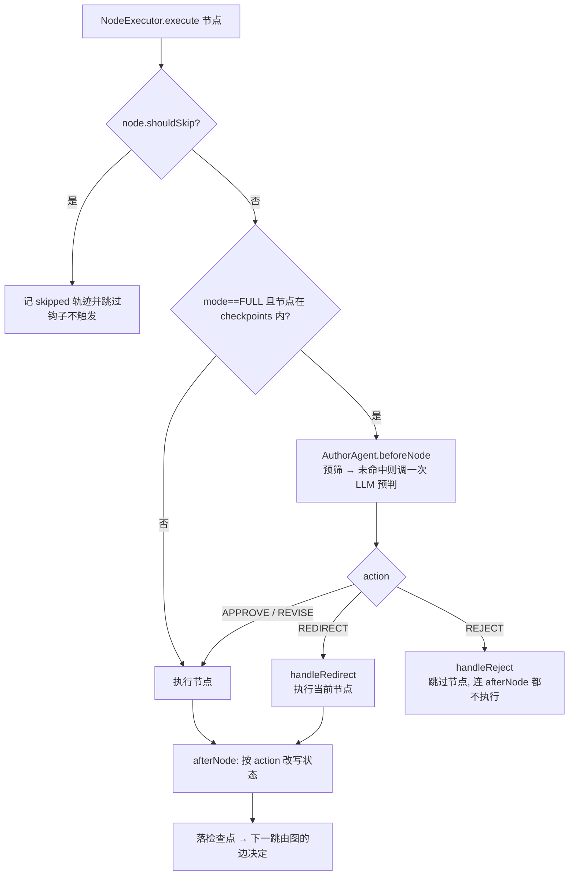

# 06 · Agent 分工与作者审校

> 本文描述 MoLan **当前实现态**的多 Agent 分工，以及「作者审校」（AuthorAgent）机制的真实语义。
> 全文论断均给出仓库内证据（`相对仓库根路径:行号`）；**未实现的能力一律不写入**，实现边界集中在第 6 章。
> 代码位置：`backend/src/main/java/com/novel/system/ai/agent/`、`.../ai/graph/`、`.../ai/chain/`。

---

## 1. 为什么是多个 Agent，而不是一个更大的提示词

把「规划—写作—摘要—校验」塞进一个提示词，真正的问题不是提示词变长，而是**每个阶段的输入集合、输出契约与校验口径互不相同**。

| 阶段 | 输入集合 | 输出契约 | 校验口径 | 模型参数 |
| --- | --- | --- | --- | --- |
| 章纲 | 总纲 / 卷纲 / 世界观 / 人物状态 / 上章指纹 / 未回收伏笔 | 纯 JSON：`title`/`summary`/`key_points`/`hook`（`backend/src/main/java/com/novel/system/ai/agent/OutlineAgent.java:98`） | 叙事结构多样性 + 禁重复已发生事件（`OutlineAgent.java:78-95`） | `STRUCTURED`，temperature 0.3（`backend/src/main/java/com/novel/system/config/LangChainConfig.java:69`） |
| 正文 | 章纲 + 六层记忆上下文 + 角色动线 + 伏笔操作 + 待修订问题 | 纯正文，无任何说明文字（`backend/src/main/java/com/novel/system/ai/agent/WritingAgent.java:115`） | 文风铁律 + 人物一致性 + 不重演已发生事件（`WritingAgent.java:89-123`） | `CREATIVE`，温度取用户配置（`LangChainConfig.java:67`） |
| 摘要 | 正文截断（头 1500 + 尾 1500 + 关键段）+ 章纲 | JSON：`fingerprint`/`strand_type`/`hook_level`（`backend/src/main/java/com/novel/system/ai/chain/ChapterGenerationChain.java:110`） | 字段可解析即可 | `STRUCTURED` |
| 卷纲 | 总纲 + 题材 + 类型 + 基调 + 雷点 | JSON 数组，每卷含 `rhythmTag`/`rhythmIntensity`（`backend/src/main/java/com/novel/system/ai/agent/VolumeOutlineAgent.java:28`） | 章节号连续、每卷 10–30 章 | `STRUCTURED`，`maxTokens ≥ 32768`（`ChapterGenerationChain.java:278`） |
| 卷级编排 | 卷纲 + 总纲 + 人物 + 已有伏笔 | JSON：每章节奏 / 视角 / 伏笔埋收 / 冲突类型（`backend/src/main/java/com/novel/system/ai/agent/ArcOrchestrationAgent.java:38-59`） | `chapters` 数组长度 == 卷章节数 | `STRUCTURED` |

因此切分依据不是「角色扮演」，而是三条工程约束：

1. **输入集合不同**——正文需要注入六层记忆与伏笔操作（`backend/src/main/java/com/novel/system/ai/graph/WritingNode.java:194-253`），章纲不需要；摘要只看正文。混在一起会互相挤占上下文预算。
2. **校验口径不同**——章纲查结构与多样性，正文查文风与一致性，两套规则若写进同一个提示词会互相稀释甚至冲突。
3. **失败语义不同**——图引擎按节点粒度重试与记账（`backend/src/main/java/com/novel/system/ai/graph/NodeExecutor.java:74-115`）；一个提示词失败就是整章失败。

附带收益是**工具集可以按需挂载**：章纲与正文 Agent 挂了人物 / 伏笔 / 小说 / 检索工具（`ChapterGenerationChain.java:155-158`、`:202-205`；`backend/src/main/java/com/novel/system/ai/tool/NovelToolProvider.java:46-57`），而摘要 Agent 不挂工具（`ChapterGenerationChain.java:246-248`）。

### 1.1 提示词的存放方式

| 位置 | 用途 | 证据 |
| --- | --- | --- |
| Agent 接口的 `@SystemMessage` | 各 Agent 的系统指令（角色、输出铁律、JSON 结构） | `OutlineAgent.java:75-99`、`WritingAgent.java:86-133` |
| `ChapterGenerationChain` 拼装的 user prompt | 小说 ID / 章节号 / 章纲 / 上下文段落 | `ChapterGenerationChain.java:160-163`、`:350-358` |
| `ContextBuilderService` | 六层记忆上下文（章纲 / 正文两套） | 见 04 篇 |
| 节点内增强段 | 角色动线、伏笔操作、待修订问题、情绪弧线 | `WritingNode.java:206-253` |
| 数据库 `prompt_template` 表 | 按 `agentType` 存系统指令 + few-shot，带版本与启用位 | `backend/src/main/java/com/novel/system/entity/mysql/PromptTemplate.java:11-31`；调用点 `backend/src/main/java/com/novel/system/ai/chain/ValidationServiceImpl.java:44` |
| 资源文件 | 去 AI 味规则集、题材规则 | `backend/src/main/resources/deslop/deslop-rules.yaml`、`backend/src/main/resources/genres/` |

> 备注：流式写作需要把基础系统指令与文风卡片拼接，`getBaseSystemMessage()` 用反射从 `WritingAgent` 的注解里取，避免重复硬编码（`ChapterGenerationChain.java:574-592`）。

---

## 2. Agent 清单

| Agent | 职责 | 输入 | 输出 | 所在节点 | 证据 |
| --- | --- | --- | --- | --- | --- |
| `OutlineAgent` | 生成章纲 | 小说 ID + 章节号 + 章纲上下文 | JSON（标题/概要/要点/钩子） | `outline` | `OutlineAgent.java:51-100`；调用 `backend/src/main/java/com/novel/system/ai/graph/OutlineNode.java:92-96` |
| `WritingAgent` | 生成正文 | 章纲 + 写作上下文 | 纯正文文本 | `writing` | `WritingAgent.java:60-134`；调用 `WritingNode.java:110-125` |
| 摘要 Agent（内部接口 `SummaryAgentAiService`） | 抽取结构化摘要 | 正文截断 + 章纲 | JSON 摘要 | `summary` | `ChapterGenerationChain.java:101-113`；调用 `backend/src/main/java/com/novel/system/ai/graph/SummaryNode.java:48-51` |
| `VolumeOutlineAgent` | 拆全书卷结构 | 总纲 / 题材 / 基调 / 雷点 | JSON 数组 | **不在生产图内**，由向导与 MCP 工具调用 | `VolumeOutlineAgent.java:12-30`；调用 `backend/src/main/java/com/novel/system/service/wizard/WizardServiceImpl.java:66`、`backend/src/main/java/com/novel/system/mcp/server/tool/CreationMcpTools.java:100` |
| `ArcOrchestrationAgent` | 卷内章节级编排 | 卷纲 + 总纲 + 人物 + 伏笔 | `ArcOrchestrationOutput` | `arc_check` | `ArcOrchestrationAgent.java:13-61`；调用 `backend/src/main/java/com/novel/system/service/orchestration/ArcOrchestrationServiceImpl.java:124` |

**DTO 的实际接线状态**（避免「有类即有功能」的误读）：

| DTO | 状态 |
| --- | --- |
| `OutlineAgentResponse`、`SummaryAgentResponse` | 真正被使用：老链式服务解析 Agent 返回值（`backend/src/main/java/com/novel/system/service/chapter/ChapterGenerationServiceImpl.java:868`、`:924`） |
| `OutlineAgentRequest`、`WritingAgentRequest`、`WritingAgentResponse`、`SummaryAgentRequest` | **只有声明、没有生产调用点**（全仓检索仅命中自身文件与 `WritingAgent.java:84` 的 javadoc 引用） |

---

## 3. 图节点的类型学

生产图定义在 `backend/src/main/java/com/novel/system/service/chapter/MultiAgentNovelService.java:38-80`，共 16 个节点（注册见 `:83-98`），可归为七类：

| 类型 | 节点 | 判定依据 |
| --- | --- | --- |
| **LLM 节点**（直调 `ChatModelProvider`） | `clue_planning`、`character_planning`、`world_validate`、`self_review`、`quality_scoring` | `CluePlanningNode.java:95`、`CharacterPlanningNode.java:53`、`SelfReviewNode.java:80`、`QualityScoringNode.java:69`、`WorldValidatorNode.java:66` |
| **Agent 节点**（LangChain4j AI Service，可挂工具） | `outline`、`writing`、`summary` | 见第 2 章 |
| **读取 + 兜底 LLM 的混合节点** | `arc_check` | 优先读已落库的卷级编排，缺失时才兜底调 `ArcOrchestrationAgent` 生成（`backend/src/main/java/com/novel/system/ai/graph/ArcOrchestrationNode.java:38-52`；`backend/src/main/java/com/novel/system/service/orchestration/ArcOrchestrationServiceImpl.java:124`） |
| **规则 / 工具节点**（确定性、无 LLM） | `deslop_check`、`continuity_validation`、`fact_lock_violation`、`idea_select` | 规则扫描 `DeslopCheckNode.java:69`；字符串匹配 `ContinuityValidationNode.java:40-54`；事实锁比对 `FactLockViolationNode.java:45-46`；思路选择直接取列表首条 `backend/src/main/java/com/novel/system/ai/graph/IdeaSelectionNode.java:22-24` |
| **条件分支节点** | `audit_router` | 输出 `PASS`/`REWRITE`/`REPLAN`/`MANUAL_REVIEW`（`backend/src/main/java/com/novel/system/ai/graph/AuditRouterNode.java:136-270`），由图的条件边消费（`MultiAgentNovelService.java:61-67`） |
| **并发汇聚节点** | `outline` → fan-out → fan-in | `clue_planning` 与 `character_planning` 并行跑，用 `MergeStrategy.chapterPlanMerge()` 拼回完整章纲（`MultiAgentNovelService.java:43-44`；`backend/src/main/java/com/novel/system/ai/graph/GraphRunner.java:168-211`） |
| **作者审校节点** | 不是独立节点，而是挂在 `outline`/`writing`/`audit_router` 三个检查点上的钩子 | 第 4 章 |
| **记忆读写 / 向量化节点** | `post_process` | 落库 + 后处理写记忆（`backend/src/main/java/com/novel/system/ai/graph/PostProcessNode.java:68`、`:73`），向量由 `ragService.saveSummary` 异步写入（`backend/src/main/java/com/novel/system/service/chapter/ChapterSaveService.java:162` → `backend/src/main/java/com/novel/system/ai/rag/RagServiceImpl.java:464-484`） |

### 3.1 节点接口的扩展点

`backend/src/main/java/com/novel/system/ai/graph/NovelGraphNode.java:3-37` 定义 6 个扩展点：

| 扩展点 | 作用 | 实现示例 |
| --- | --- | --- |
| `apply` | 节点主体，返回新的不可变状态 | 所有节点 |
| `nodeName` | 节点标识，决定边、检查点、审校检查点的匹配 | `OutlineNode.java:41` |
| `shouldSkip` | 命中则跳过节点并记一条 skipped 轨迹（**在钩子之前判定**） | `OutlineNode.java:60-62`（章纲已存在则跳过）、`WritingNode.java:69-72`（已有可用草稿则跳过） |
| `errorStrategy` | 失败后 SKIP / RETRY / FAIL | `OutlineNode.java:54`、`WritingNode.java:63`、`AuditRouterNode.java:47` |
| `maxRetries` | 仅 `errorStrategy=RETRY` 时生效 | `OutlineNode.java:57`、`WritingNode.java:66` |
| `resetState` | 流程重新路由回本节点时如何清理状态 | `OutlineNode.java:44-51`（清章纲）、`WritingNode.java:50-60`（草稿严重度抬 HIGH） |

运行模式三档：`FAST` / `STREAMING` / `FULL`（`backend/src/main/java/com/novel/system/ai/graph/Mode.java:3-7`），**同一张图按模式裁剪**，不是三张图。

---

## 4. 作者审校（AuthorAgent）的真实语义

### 4.1 钩子在哪里、做什么

接口只有两个同步方法（`backend/src/main/java/com/novel/system/ai/graph/AuthorAgent.java:5`、`:7`）。`NodeExecutor` 在**节点执行之前**调用 `beforeNode`（`NodeExecutor.java:35-49`），在**节点执行之后**调用 `afterNode`（`NodeExecutor.java:54-57`）。

触发条件（三者同时满足）：

| 条件 | 证据 |
| --- | --- |
| 运行模式为 `FULL` | `NodeExecutor.java:35` |
| 节点名在 `checkpoints` 列表内（默认 `outline`/`writing`/`audit_router`） | `backend/src/main/java/com/novel/system/ai/graph/AuthorAgentConfig.java:14`；判定 `AuthorAgentImpl.java:29-33` |
| 节点名在 `LLM_CHECKPOINTS` 内（与上面同一组） | `backend/src/main/java/com/novel/system/ai/graph/AuthorAgentImpl.java:23-25`、`:35-39` |

触发时做的是**一次 LLM 预判**：

```java
String prompt = buildBeforePrompt(nodeName, state);
String response = chatModelProvider.getStructuredModel(state.getLlmConfigId()).chat(prompt);
```

（`AuthorAgentImpl.java:58-60`；模型温度 0.3，与章节生成同一份 `llmConfigId`。）

**这里不等待作者在流程中途输入**——没有阻塞点、没有「挂起等人回答」的状态、没有作者回复回流通道。详见第 6 章。

### 4.2 三个检查点各自看到什么

| 检查点 | 真正触发的时机 | 送给 LLM 的内容 |
| --- | --- | --- |
| `outline` | **首次**进入 outline（此时 `chapterPlan` 为空）；REPLAN 回流时因 `shouldSkip` 命中而**不再触发** | 首轮是「即将生成章纲，请预判方向」（`AuthorAgentImpl.java:218`） |
| `writing` | **首次**进入 writing；以及上一稿 `severity=HIGH` 的重写轮 | 首轮是「即将生成正文」（`AuthorAgentImpl.java:239`）；重写轮显示上一稿字数 / 严重度 / 修订意见 + 正文前 3000 字预览（`AuthorAgentImpl.java:241-258`） |
| `audit_router` | 审校结果产出之后（该节点无 `shouldSkip`） | OOC / 逻辑 / 伏笔 / 设定 / 节奏是否通过、质量分、综合结论、建议（`AuthorAgentImpl.java:265-283`） |

> **跳过判定先于钩子**：`NodeExecutor.java:27-32` 在 `:35` 之前。因此「审稿」实质发生在**重写轮**（有上一稿可审），首轮的钩子只能算「预判」。

### 4.3 预筛：多数情况下作者根本不会说话

`preFilterEnabled` 默认开启（`AuthorAgentConfig.java:17`），命中规则直接返回 `APPROVE`、**不调 LLM**（`AuthorAgentImpl.java:42-53`）：

| 检查点 | 预筛放行条件 | 证据 |
| --- | --- | --- |
| `outline` | 章纲结构完整（标题/概要/要点/钩子齐全）**且**无创作意图、无叙事方向 | `AuthorAgentImpl.java:318-337` |
| `writing` | 草稿自审 LOW、无修订意见、字数在 `[1000, 8000]` **且**无创作意图、无叙事方向 | `AuthorAgentImpl.java:339-355`（阈值 `AuthorAgentConfig.java:18-19`） |
| `audit_router` | 全部校验通过且质量分 ≥ 90 | `AuthorAgentImpl.java:357-370`（阈值 `AuthorAgentConfig.java:20`） |

推论：**只要作者给了创作意图或叙事方向，章纲与正文两个检查点的预筛全部失效**，必定产生一次真实 LLM 审校调用；而审校检查点的预筛只看审校结果，与作者意图无关。首轮因为章纲/草稿都还不存在，章纲与正文两个检查点的预筛必然落空——即 FULL 模式每章至少 2 次、最多 3 次额外 LLM 调用。

### 4.4 四种动作的真实行为

`AuthorDirective.Action` 共四态（`backend/src/main/java/com/novel/system/ai/graph/AuthorDirective.java:16-21`）；`shouldIntervene()` 判定为「非 APPROVE 即介入」（`AuthorDirective.java:35-37`）。

| 动作 | 触发与实现位置 | 真实效果 |
| --- | --- | --- |
| `APPROVE` | 预筛命中 / LLM 判定合规 / 解析失败或调用异常兜底（`AuthorAgentImpl.java:30-32`、`:71-73`、`:312-314`） | 不改状态，继续执行节点 |
| `REVISE` | `afterNode` 分派 `AuthorAgentImpl.java:91-93` → `applyRevisionDirective`（`:107-135`） | 改写状态：`outline` 检查点把「【作者修订】+ notes」追加到**该节点刚生成**的 `chapterPlan.summary`；`writing` 检查点把**该节点刚生成**草稿的 `severity` 置 `HIGH`、把 `creativeNotes` 追加进 `revisionNotes` |
| `REJECT` | `NodeExecutor.java:44-46` → `handleReject`（`:137-145`） | **跳过该节点**：既不执行 `apply`，也**不执行 `afterNode`**，只记一条元数据为 `{"action":"author_rejected"}` 的轨迹 |
| `REDIRECT` | `NodeExecutor.java:41-43` → `handleRedirect`（`:117-135`） | **不跳过当前节点**：先执行节点，再由 `afterNode` 的 `applyRedirectDirective` 注入状态（`:163-176`） |

`REVISE` 的效果要读三层，因为它的状态改写发生在**节点执行之后**：

1. **章纲检查点**：追加的「【作者修订】…」落在刚生成的章纲摘要上，随后 `plan.getSummary()` 会作为章纲进入正文 prompt（`WritingNode.java:79`、`:116`、`:122`），因此该意见能真正影响正文。
2. **正文检查点**：作者把草稿严重度抬到 `HIGH` 并写入 `creativeNotes`，但**紧接着的 `self_review` 会用自己的判定覆盖 `severity` 与 `revisionNotes`**（`backend/src/main/java/com/novel/system/ai/graph/SelfReviewNode.java:83-89`），所以作者的 HIGH 并不必然触发重写。
3. **真正生效的通道**：只有当流程经 `deslop_check` 判 REWRITE 提前回到 writing 时，`WritingNode` 才会从旧草稿的 `revisionNotes` 读回这些意见并注入 prompt 的「=== 待修订问题 ===」段（`WritingNode.java:146-154`、`:235-243`）。审校轮的意见另有一条更可靠的通道——`audit_router` 把结论写进 `pendingRevisionNotes`（`backend/src/main/java/com/novel/system/ai/graph/AuditRouterNode.java:155-157`、`:169-171`）。

### 4.5 REDIRECT 的真实作用（最容易被误解的一点）

三件事必须说准：

1. **它不切换节点**。`handleRedirect` 先执行当前节点、再调 `afterNode`（`NodeExecutor.java:117-135`）；代码注释在 `:123-125` 明确写着「REDIRECT 不应跳过节点执行……然后继续执行当前节点，而非返回未执行的空状态」。**下一跳由图的边决定**（`GraphRunner.java:220-251`），与指令里的目标无关。
2. **它改的是状态**。`applyRedirectDirective` 把 `auditDecision` 置为 `"REPLAN"`，并在目标为 `outline` 时清空 `chapterPlan` 与 `preWriteValidation`（`AuthorAgentImpl.java:163-176`）。
3. **它的目标恒等于当前节点**。`parseDirective` 根本不解析目标字段，`beforeNode` 随后用 `directive.setTargetNode(nodeName)` 覆盖（`AuthorAgentImpl.java:61`）。所以「目标 == outline」只可能发生在 outline 检查点。

净效果：在 outline 检查点给出 REDIRECT → outline 节点照常执行并生成新章纲 → `afterNode` 随即把这份章纲清掉（`chapterPlan=null`、`preWriteValidation=null`）→ 后续按图定义继续。

> **一个必须知道的后果**：`outline` 检查点触发时 `chapterPlan` 必为 null（否则节点会被 `shouldSkip` 跳过，钩子根本轮不到），因此 REJECT / REDIRECT 之后状态里仍是「没有章纲」。而两个扇出分支都直接解引用 `state.getChapterPlan()`、没有判空（`CluePlanningNode.java:38`、`:93`；`CharacterPlanningNode.java:33`、`:51`），会抛 NPE 并按 SKIP 策略记一条可恢复错误（`NodeExecutor.java:108-111`），最终在 writing 节点以「章纲数据缺失，无法生成正文」失败（`WritingNode.java:79-84`）。换句话说：**在 outline 检查点否决或重定向，等于让本章生成失败**，而不是「换一个作者认可的方向重做」。

### 4.6 作者的真实干预入口

| 入口 | 来源 | 进入时机 | 影响范围 |
| --- | --- | --- | --- |
| **用户意图**（`userIntent`） | 接口参数 → 状态（`MultiAgentNovelService.java:106-110`、`:140-145`） | **生成开始前** | 注入作者审校提示词的「【作者意图】」（`AuthorAgentImpl.java:182-184`）；使章纲 / 正文两个预筛失效（`:329`、`:347`）；并随章节落库（`PostProcessNode.java:73`） |
| **叙事方向**（`narrativeDirection`） | 作者 Agent 自己上一轮 LLM 输出的字段（`AuthorAgentImpl.java:308`），经上一次检查点的 directive 留在状态里（`NodeExecutor.java:50`） | 下一个检查点读取时 | 注入「【叙事方向】」（`AuthorAgentImpl.java:186-188`）并使预筛失效（`:331`、`:349`） |

两条重要边界：

- `userIntent` 在多 Agent 图路径里**不进入章纲 / 正文的生成上下文**——`ContextBuilderService` 中检索不到 `userIntent`；它只到达「作者审校提示词」与「落库字段」两处。
- `narrativeDirection` 目前**没有人类输入入口**：全仓检索该字段只命中 `AuthorAgentImpl.java` 与 `AuthorDirective.java:33`，前端亦无对应字段。它是「作者 Agent 上一轮决策的方向延续」，不是作者实时下达的指令。

### 4.7 钩子时序（FULL 模式）



---

## 5. 调用可观测性

| 机制 | 记录什么 | 位置 | 当前接线状态 |
| --- | --- | --- | --- |
| `LlmCallRecord` | 节点名、模型名、输入 / 输出 / 总 token、耗时毫秒、时间戳 | `backend/src/main/java/com/novel/system/ai/graph/LlmCallRecord.java:5-14` | 类型已定义 |
| `TracingChatModel` | 包装 `ChatModel`，调用结束后把 token 用量与耗时交给 recorder | `backend/src/main/java/com/novel/system/ai/graph/TracingChatModel.java:24-45`；工厂方法 `backend/src/main/java/com/novel/system/ai/graph/ChatModelProvider.java:60-64` | 工厂方法 `getTracingModel` 在**生产代码中没有调用点**（仅测试用例使用），因此 `state.llmCalls` 目前恒为空 |
| `StateHelper.appendLlmCall` | 把一条 `LlmCallRecord` 追加进状态 | `backend/src/main/java/com/novel/system/ai/graph/StateHelper.java:45-49` | 生产代码未调用（仅测试调用） |
| `AgentMetrics` | Micrometer 指标：节点耗时 / 重试 / 错误、LLM 调用次数与 token、单章总耗时、审校决策计数 | `backend/src/main/java/com/novel/system/ai/graph/AgentMetrics.java:22-55` | 已注册为 `@Component`，但计数入口（`recordNodeDuration` 等）在生产代码中无调用点 |
| `NodeExecutionRecord` | 每次节点执行的名称 / 模式 / 起止时间 / 耗时 / 是否跳过 / 错误策略 / **当时的作者指令** / 元数据 | `backend/src/main/java/com/novel/system/ai/graph/NodeExecutionRecord.java:7-25` | 在用；轨迹经 `MultiAgentNovelService.java:168-171` 压平为字符串列表随接口返回 |
| checkpoint SSE 事件 | 节点名 + action + rationale | `NodeExecutor.java:150-164`；前端接收 `frontend/src/views/NovelDetail.vue:828-833` | 前端有接收与展示代码，但见 §6.4——生产入口下不可达 |

结论：作者审校的决策**有留痕**（`NodeExecutionRecord.directive` + 服务端日志 `AuthorAgentImpl.java:63-66`、`:85`），但**逐次 LLM 调用的 token / 耗时在当前实现中并未被采集**——追踪包装器与指标埋点都已就位，却尚未接入节点执行路径。

---

## 6. 实现边界（必须如实说明）

1. **作者介入次数没有上限。** `AuthorAgentConfig.java:15` 声明了 `maxInterventions = 3`，但全仓检索该字段**只有这一处声明**，没有任何读取点（`getMaxInterventions()` 无调用方），该配置项实际不生效。作者审校的次数只被图的迭代上限 20 步与节点级重试预算间接约束（`GraphRunner.java:21`、`:86-92`；`GraphRunner.java:259-278`）。
2. **系统内不存在「生成中途暂停等作者回答」的交互形态。** AuthorAgent 只有 `beforeNode` / `afterNode` 两个同步钩子（`AuthorAgent.java:5-7`），调用方 `NodeExecutor` 同步执行（`NodeExecutor.java:36`、`:55`）；状态里没有「等待人类输入」的字段，也没有「作者回复 → 恢复流程」的通道。checkpoint SSE 事件是单向推送（`NodeExecutor.java:159`），前端只把它 push 进列表展示（`frontend/src/views/NovelDetail.vue:828-833`）。唯一与人有关的挂起点是 `idea_select` 节点里的 `TODO: Human-in-the-Loop — 多个思路时暂停等待用户选择`（`IdeaSelectionNode.java:26`），该 TODO **尚未实现**，当前行为是直接取第一条思路（`IdeaSelectionNode.java:22-24`）。
3. **`REJECT` 的状态改写分支当前不可达。** `applyRejectionDirective`（`AuthorAgentImpl.java:137-161`）只在 `afterNode` 里被调用，而 `REJECT` 在 `NodeExecutor.java:44-46` 已提前返回，`afterNode` 不执行；因此该方法里的「清章纲 / 置 REWRITE」逻辑在当前实现中不会生效。
4. **checkpoint SSE 事件在现有生产入口下不会真正发出。** 作者审校只在 `Mode.FULL` 触发（`NodeExecutor.java:35`），而模式是「有 `SseEmitter` 就 STREAMING、否则 FULL」（`MultiAgentNovelService.java:157`）——FULL 模式下没有 emitter，STREAMING 模式下没有作者审校，两者互斥。
5. **`MANUAL_REVIEW` 不构成人工介入挂起点。** `AuditRouterNode.java:265-270` 只是把 `auditDecision` 置为该字符串，而生产图在 `audit_router` 上只定义了 PASS / REPLAN / REWRITE 三条条件边（`MultiAgentNovelService.java:61-67`）；`MANUAL_REVIEW` 会落到 `audit_router` 的兜底节点 `fact_lock_violation` 并继续走完流程。
6. **不存在 Provider 自动切换，也不存在按配额限流。** `ChatModelProvider.getModel` 只按 id 取单个配置，取不到直接抛异常（`ChatModelProvider.java:30-41`），`LangChainConfig` 中同样没有 failover 逻辑。
7. **没有独立的执行轨迹时间线页面。** 轨迹以字符串列表随接口返回（`MultiAgentNovelService.java:168-171`），节点级耗时以服务端日志为准。
8. **无向量化节点级失败重试。** 向量写入在 `post_process` 之后异步进行（`ChapterSaveService.java:162`），失败只记录日志，不回滚章节。

---

## 7. 相关文档

- `02-图编排引擎.md` —— 图定义、路由、扇出扇入、重试预算与错误隔离
- `03-写作图与生成链路.md` —— 生产图定义、三档模式、完整节点清单
- `04-长程记忆子系统.md` —— 六层记忆的写入 / 读取时机与检索规则
- `07-质量门禁与审校路由.md` —— 质量关口、审校维度与路由决策
