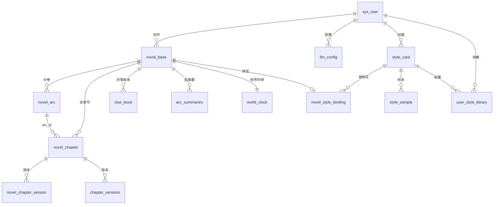

# 08 数据模型与存储边界

> 本文描述**当前实现态**（仓库 `main` 分支）的数据模型，以及四类存储（MySQL / MongoDB / Milvus / Redis）的职责切分。
> 所有论断均给出 `相对仓库根的路径:行号` 证据；未实现的规划项集中列在第 6 节。

---

## 1. 选型与切分原则

系统用了四种存储，不是为了「炫技」，而是四种数据在**查询方式、生命周期、结构稳定性**上完全不同：

| 判据 | 落到哪个库 | 典型数据 | 代码依据 |
| --- | --- | --- | --- |
| 结构稳定、需要精确条件查询、需要外键级联 | **MySQL** | 章节正文、伏笔账本、弧段摘要、模型/模板/风格配置 | `backend/src/main/java/com/novel/system/entity/mysql/`（14 个实体）、`backend/src/main/resources/mapper/*.xml` |
| 结构随创作推进演进、整体读写、无需 DDL 迁移 | **MongoDB** | 故事状态、角色档案、事件图谱、卷级编排 | `backend/src/main/java/com/novel/system/entity/mongo/`（10 个 `@Document`） |
| 需要「近义」而非「等值」的召回 | **Milvus** | 章节剧情指纹的向量副本 | `backend/src/main/java/com/novel/system/ai/rag/MilvusVectorStoreServiceImpl.java:122-195` |
| 短期高频、可重建、允许过期 | **Redis** | Agent 检查点、流式上下文、任务状态、向导进度、模板缓存 | `backend/src/main/java/com/novel/system/config/RedisKeyProvider.java:20-38` |

**各自「存什么 / 不存什么」**

- **MySQL**：权威业务主数据。不存向量（`RagServiceImpl.java:471` 注释明确「仅存 Milvus，不再冗余存 MongoDB」），不存随创作自由演化的记忆体。
- **MongoDB**：创作记忆（世界状态/人物/事件/编排）。不存需要外键一致性的主数据；正文与伏笔账本一律留在 MySQL。
- **Milvus**：**派生索引**，可由 MongoDB 的 `chapter_summary.embedding` 一次性迁移重建（`MilvusVectorStoreServiceImpl.java:365-436`）。权威正文永远在 MySQL。
- **Redis**：全部可重建的临时态。任何一条 Redis 数据丢失都不影响持久化结果——上下文丢了可从数据库恢复（`ChapterGenerationServiceImpl.java:211-214`）。

---

## 2. MySQL 业务主数据

### 2.1 表清单

| 表名 | 实体（`entity/mysql/`） | 关键字段 | 用途 | 关联 |
| --- | --- | --- | --- | --- |
| `sys_user` | `User.java:12` | `user_id`、`username`、`password`(BCrypt)、`role`、`status` | 账号主体 | → `novel_base.user_id`、`llm_config.user_id` |
| `novel_base` | `NovelBase.java:13` | `novel_id`、`genre`、`total_outline`、`world_setting`、`llm_config_id`、`word_count`、`status`、`is_deleted` | 小说主档 | → `sys_user`、`llm_config` |
| `novel_arc` | `NovelArc.java:10`（表名见 `NovelArcMapper.xml:21`） | `arc_id`、`start_chapter`、`end_chapter`、`rhythm_tag`、`rhythm_intensity`、`chapter_plan`(JSON) | 卷/弧线 | `novel_base.novel_id` |
| `novel_chapter` | `NovelChapter.java:12` | `chapter_id`、`chapter_num`、`chapter_outline`、`content`、`plot_fingerprint`、`hook`、`key_points`、`chapter_summary`、`synopsis_id` | 章节主档（唯一键 `novel_id+chapter_num`，见 `moyun_novel_system.sql:226`） | `novel_base.novel_id`、`novel_arc.arc_id` |
| `novel_chapter_version` | `NovelChapterVersion.java:10` | `version_id`、`chapter_id`、`version_desc` | 章节历史版本（含重写场景快照） | `novel_chapter.chapter_id` |
| `chapter_versions` | `ChapterVersion.java:15` | `id`、`chapter_id`、`version`、`outline`、`words` | 带版本号的滚动快照，只保留最近 10 版（`ChapterVersionService.java:26`、`:57-60`） | `novel_chapter.chapter_id` |
| `clue_book` | `ClueBook.java:12` | `clue_id`、`bury_chapter`、`recycle_chapter`、`status`、`priority`、`related_characters`、`deadline` | 伏笔账本（第二层记忆） | `novel_base.novel_id` |
| `arc_summaries` | `ArcSummary.java:15` | `id`、`novel_id`、`chapter_from`、`chapter_to`、`summary` | 弧段摘要（第四层记忆 4a） | `novel_base.novel_id`（逻辑关联） |
| `world_clock` | `WorldClock.java:10`（表名见 `WorldClockMapper.xml:19`） | `novel_id`(唯一)、`current_date`、`season`、`weather`、`total_days` | 世界时钟，每本一行 | `novel_base.novel_id` |
| `llm_config` | `LlmConfig.java:12` | `config_id`、`model_name`、`base_url`、`api_key`、`usage_type`、`embedding_model`、`is_active` | 用户自配模型 | `sys_user.user_id` |
| `prompt_template` | `PromptTemplate.java:10`（表名见 `PromptTemplateMapper.xml:23`） | `agent_type`、`system_instruction`、`few_shot_examples`、`version`、`is_active` | 各 Agent 的提示词模板 | 无外键，全局共享 |
| `style_card` | `StyleCard.java:24` | `card_id`、`rhythm_rules`/`dialogue_rules`/`forbidden_rules` 等 JSON 规则、`samples_json`、`stats_json` | 可复用文风资产 | `created_by → sys_user` |
| `style_sample` | `StyleSample.java:25` | `sample_id`、`card_id`、`sample_type`、`content`、`annotation` | 文风原文片段（few-shot） | `style_card.card_id` |
| `user_style_library` | `UserStyleLibrary.java:22` | `user_id`、`card_id`、`is_favorite` | 用户收藏夹（唯一键 `user_id+card_id`） | `sys_user`、`style_card` |
| `novel_style_binding` | `NovelStyleBinding.java:22` | `id`、`novel_id`(唯一)、`card_id` | 小说绑定文风卡片（一小说一卡） | `novel_base`、`style_card` |

> DDL 中另有 `genre_template`、`chapter_synopses` 两张表，当前代码**没有**对应实体或 Mapper；`novel_chapter.synopsis_id` 仅在注释里指向 `chapter_synopses`（`NovelChapter.java:74-77`）。

### 2.2 ER 关系（文字版）

### 2.3 `clue_book.deadline`（伏笔回收截止章节）的写入路径

DDL：`deadline int NULL DEFAULT NULL COMMENT '伏笔回收截止章节'`（`backend/moyun_novel_system.sql:89`）；实体 `ClueBook.java:37-41`；XML 三处齐备——resultMap（`ClueBookMapper.xml:17`）、insert 列（`ClueBookMapper.xml:49-52`）、update 语句（`ClueBookMapper.xml:65`）。

写入共三条路径：

1. **用户显式指定**：`ClueController.java:43`（`clue.setDeadline(request.getDeadline())`，前端也可用别名 `deadlineChapter`，见 `CreateClueRequest.java:61-64`）→ `ClueBookServiceImpl.createClue()` 落库（`ClueBookServiceImpl.java:52`）。
2. **未指定时自动推导**：`ClueBookServiceImpl.java:44-51` 调用 `resolveDeadline(buryChapter)`（`:57-62`），规则是 `deadline = 埋设章节 + DEFAULT_DEADLINE_CHAPTERS`，常量取 5（`:33`）。取 5 是为了与读取侧窗口自洽：大纲阶段 `chapterNum >= deadline-5` 标「紧急」（`ContextBuilderService.java:299`）、写作阶段 `>= deadline-3` 标「紧急」（`ContextBuilderService.java:594`）、规则召回 `>= deadline-5`（`RuleDrivenRetrievalService.java:35-36`）。
3. **正文后处理自动抽取伏笔**：`ChapterPostProcessService.java:511-512` 显式调用 `clueBookService.resolveDeadline(chapterNum)` 后再 `createClue`。

读取侧对 `null` 做了保护（`ContextBuilderService.java:298`、`:593`），因此手写 SQL 插入、`deadline` 为空的伏笔不会导致空指针，但也不会进入紧急提示。

### 2.4 `arc_summaries`（弧段摘要）的写入路径

**表结构**：`id` 自增主键、`novel_id`、`chapter_from`、`chapter_to`、`summary`、`create_time`，索引 `idx_novel_range(novel_id, chapter_from, chapter_to)`；**表上没有唯一键**（`backend/moyun_novel_system.sql:27-36`）。列定义见 `ArcSummaryMapper.xml:16-18`。

**唯一标识是 `(novel_id, chapter_from)`**，但幂等不是靠数据库约束，而是应用层「先查后写」实现（`ArcSummaryServiceImpl.java:23-24`、`:165-191`）。

写入路径：

1. **触发点**：章节落库之后由 `ChapterSaveService.java:145-152` 调用 `arcSummaryService.refreshArcSummaryIfCompleted(novelId, chapterNum)`，整段被 try/catch 包住——**弧摘要失败不影响章节保存**。
2. **定位弧段**：`novel_arc.start_chapter ~ end_chapter`（`ArcSummaryServiceImpl.java:48`，SQL 见 `NovelArcMapper.xml:29`）。
3. **是否可写**：配置了 `end_chapter` 时必须写完该章才写；未配置（开放弧段）则每写一章刷新一次，`chapter_to` 取当前最大章节号（`:62-72`、`:95-98`）。
4. **数据源只用 MySQL**：从 `novel_chapter` 取弧段内章节（`NovelChapterMapper.java:46-51`，过滤 `is_deleted=0`），刻意不依赖 Mongo 的 `chapter_summary`（`:21-22` 注释）。
5. **文本聚合**：每章一行「第N章《标题》：要点」，要点优先级为 `chapter_summary → plot_fingerprint → chapter_outline → 正文开头`（`:126-130`），单章要点截断 80 字、整篇摘要截断 1000 字（`:36`、`:39`）。
6. **Upsert**：先按 `(novel_id, chapter_from)` 查 `LIMIT 1`，存在则更新 `chapter_to`+`summary` 并同步 `create_time`（表无 `update_time`），不存在则插入（`:166-190`）。

**读取路径**：`ContextBuilderService.java:94-95` 与 `:410` 调用 `selectByNovelIdAndRange(novelId, chapterNum)`，按 `chapter_to <= 当前章` 过滤，作为「全书故事线回顾」注入提示词。

---

## 3. MongoDB 创作记忆（10 个集合）

| 集合 | 文档类 | 关键字段 | 作用 | 索引 |
| --- | --- | --- | --- | --- |
| `story_state` | `StoryState.java:19` | `novelId`(唯一)、`version`、`timeline`、`protagonist`、`sceneContext`、`pacingState`、`recentMajorEvents`、`narrativeFlags`、`convergenceState`、`compressedBackstory` | 五层记忆**第一层**：故事实时状态，每章生成后更新并全量注入 | `novelId` 唯一（`:29`） |
| `character_state` | `CharacterState.java:19` | `characterId`、`novelId`、`role`、`coreTraits`、`voiceStyle`、`currentStatus`、`relationshipMap`、`growthNodes`、`knowledge`、`behaviorPatterns`、`forbiddenBehaviors` | 第三层：角色档案与成长轨迹 | `characterId`/`novelId` 索引（`:30`、`:34`） |
| `event_graph` | `EventNode.java:20` | `chapter`、`type`、`characters`、`location`、`content`(≤200字)、`linkedEvents`、`importance`、`tags` | 第五层：事件图谱节点，永不压缩 | 三个复合索引（`:21-25`） |
| `novel_graph` | `NovelGraph.java:13` | `_id = novelId`、`nodes[]`(`id`/`name`/`type`)、`edges[]`(`source`/`target`/`relation`/`intimacyLevel`/`conflictLevel`) | 第五层：实体节点与关系边 | 以 `novelId` 作 `_id`（`:17-18`） |
| `chapter_summary` | `ChapterSummary.java:17` | `novelId`、`chapterNum`、`content`、`keywords`、`characters`、`locations`、`priority`、`emotion`、`relations`、`embedding` | 第六层：RAG 数据源 | `novelId`/`chapterNum` 索引 + `content`/`keywords` 文本索引（`:28-41`） |
| `arc_orchestrations` | `ArcOrchestration.java:17` | `arcId`(唯一)、`arcName`、`overallRhythm`、`climaxChapters`、`chapters[]`(`ChapterPlan`：节奏/视角/伏笔计划/冲突/结局) | 卷级编排计划，章纲生成的全局约束 | `arcId` 唯一、`novelId` 索引（`:27-32`） |
| `character_voice_samples` | `CharacterVoiceSample.java:13` | `novelId`、`characterName`、`dialogue`、`context`、`chapterNum`、`emotion` | 角色语气样本，供对话风格模仿 | `(novelId, chapterNum desc)` 复合索引（`:14`） |
| `completed_beats` | `CompletedBeats.java:14` | `novelId`(唯一)、`beats[]`(`beatId`/`summary`/`chapterNum`/`charactersInvolved`/`plotThread`) | 已完成情节点清单，防重复桥段 | `novelId` 唯一（`:23`） |
| `emotion_ledger` | `EmotionLedger.java:14` | `novelId`(唯一)、`version`、`entries[]`(`wound`/`boon`/`powerShift`/`openLoops`) | 情绪账本：创伤、收获、实力变化、悬念 | `novelId` 唯一（`:23`） |
| `fact_lock` | `FactLock.java:13` | `novelId`(唯一)、`knownCharacters`、`deathRecords`、`relationshipLocks`、`timelineAnchors`、`worldRuleLocks` | 事实锁：已死角色、不可改关系、时间锚点、世界规则 | `novelId` 唯一（`:22`） |

**schema-free 的收益**：这些文档的结构是**跟着创作推进长出来的**——`StoryState` 要加「叙事标记」，`CharacterState` 要加「成长节点」，都不需要改表结构或做数据迁移，只要在 POJO 上加字段即可（Spring Data MongoDB 直接映射 POJO，索引自动创建见 `application.yml:48`）。

值得注意的是**五层记忆架构本身就跨库**：第 1/3/5/6 层在 MongoDB（见各实体类注释 `StoryState.java:16`、`CharacterState.java:16`、`EventNode.java:15`、`ChapterSummary.java:14`），而第 2 层伏笔账本（`ClueBook.java:8`）与第 4 层弧摘要（`ArcSummary.java:12`）在 MySQL——因为这两层要做**精确条件查询**（按 `deadline` 判紧急、按 `chapter_to` 取历史弧段），而不是语义召回。

---

## 4. Milvus 向量集合

- **集合名**：`novel_summary`（`MilvusVectorConfig.java:28`、`application.yml:94`）
- **字段**（`MilvusVectorStoreServiceImpl.java:126-173`）：

| 字段 | 类型 | 说明 |
| --- | --- | --- |
| `id` | VarChar(256) | 主键，`autoID=false`，值形如 `<novelId>:ch<chapterNum>`（`:398`、`RagServiceImpl.java:483`） |
| `novelId` | VarChar(128) | **分区键**（`isPartitionKey(true)`，`:135-140`） |
| `chapterNum` | Int64 | 章节号；全局压缩记忆用 0（`RagServiceImpl.java:541`） |
| `content` | VarChar(65535) | 剧情指纹正文 |
| `keywords` | VarChar(1024) | 关键词，逗号拼接 |
| `priority` | Int64 | 优先级（伏笔相关用） |
| `embedding` | FloatVector | 维度取配置 `milvus.dimension`，默认 **1024**（`MilvusVectorConfig.java:31`） |

- **索引**：`HNSW`，度量 `COSINE`，`M=16`、`efConstruction=256`（`MilvusVectorConfig.java:34-42`；建索引代码 `MilvusVectorStoreServiceImpl.java:180-185`）。
- **检索过滤**：`@novelId:{xxx}` 翻译为 `novelId == "xxx"`，且 novelId 必须通过 `^[a-zA-Z0-9\-]+$` 白名单校验（`:348-360`）。
- **降级行为**：连接失败置 `degraded=true`（`:72-75`），检索直接返回空列表（`:266-275`），并有 5 分钟一次的重连定时任务（`:90-99`）。

---

## 5. Redis 键空间设计

统一由 `RedisKeyProvider` 拼接前缀（`config/RedisKeyProvider.java:20-38`），前缀取配置项 `novel.redis.key-prefix`，默认 `xpb:`（`application.yml:159-162`）。

| 键模式 | 用途 | TTL | 依据 |
| --- | --- | --- | --- |
| `{p}novel:checkpoint:<novelId>:<chapterNum>:<nodeName>` | Agent 管线节点检查点（`outline`/`writing`/`audit_router`） | 1 小时 | `StateCheckpointService.java:19`、`:45`、`:97-99` |
| `{p}novel:context:<novelId>:<chapterNum>` | 章纲→正文的生成上下文中间态 | 30 分钟 | `ChapterGenerationServiceImpl.java:87`、`:164-166`、`:549-551` |
| `{p}novel:task:status:<taskId>` | 异步生成任务状态（供前端轮询） | 24 小时 | `ChapterGenerationServiceImpl.java:421-426`、`MultiAgentChapterGenerationService.java:168-173` |
| `{p}novel:wizard:batch:<taskId>` | 向导批量生成的进度快照 | 24 小时 | `WizardServiceImpl.java:517-524` |
| `{p}novel:wizard:batch:cancel:<taskId>` | 向导批量生成取消标志 | 24 小时 | `WizardServiceImpl.java:481-486` |
| `{p}novel:cancel:<novelId>` | SSE 流式写作的取消标志（由 `/chapter/cancel` 写入；**单章流式链路内只写不读**，真正停图靠内存 `cancelFlag`） | 10 分钟 | `StreamingChapterController.java:119`、`:223`；读取方见 03 篇第 7 节 |
| `xpb::promptTemplates::<agentType>` | Spring Cache 的提示词模板缓存（缓存 key-prefix 已含尾部 `::`） | 1 小时 | `application.yml:67-73` + `PromptTemplateServiceImpl.java:35`（`@Cacheable(value="promptTemplates", key="#agentType")`） |

**TTL 策略**：检查点与上下文是「生成中途的中间态」，短 TTL（1 小时 / 30 分钟）即可；任务状态与向导进度是用户会回来查看的异步产物，给 24 小时；取消标志是瞬时信号，10 分钟足够覆盖一次 SSE 会话（SSE 超时本身也是 10 分钟，`StreamingChapterController.java:100`）。

**前缀与 ACL 约定（部署侧设计，不是 bug）**：部署环境的 Redis 开启了 ACL，**只授权带 `xpb:` 前缀的键**。这写在了代码注释里（`RedisKeyProvider.java:6-9`：避免出现「写了但没权限」的静默失败），因此所有业务键必须经由 `RedisKeyProvider` 拼接前缀，Spring Cache 也用同一前缀（`application.yml:73`）。若绕过该类直接写无前缀的键，会被 ACL 拒绝——这属于**多租户/多账号隔离设计**，不是缺陷。

---

## 6. 边界与已知约束（如实记录）

1. **Redis 没有按用户维度的配额计数 key。** `RedisKeyProvider` 暴露的前缀只有 `checkpoint`/`context`/`taskStatus`/`wizardBatch`/`cancel` 五个（`config/RedisKeyProvider.java:20-38`），全仓库检索 `quota`/`配额`/`限流` 只命中 LLM 重试预算的注释（`ai/graph/NovelAgentState.java:91`、`ai/graph/DeslopCheckNode.java:25`），与 Redis 无关。**按用户维度的配额限流属规划项，当前未实现。**
2. **向量集合的写入依赖用户配置的嵌入模型，未配置时集合保持为空。** `EmbeddingService.getEmbeddingModel()` 先找 `usage_type=embedding` 的 `llm_config`，找不到回退 `usage_type=all`（`ai/rag/EmbeddingService.java:194-214`）；两者都没有时 `embed()` 抛 `IllegalStateException`（`:49-52`），`RagServiceImpl.saveSummary` 捕获后**跳过向量保存**、摘要仍写 MongoDB（`ai/rag/RagServiceImpl.java:488-490`）。此时 Milvus 集合为空、向量检索不可用——**不能断言「向量检索一定可用」**，它取决于用户是否配置了可用的嵌入模型。
3. **Milvus 是可重建的派生数据。** 集合可从 MongoDB `chapter_summary.embedding` 一次性迁移回来（`MilvusVectorStoreServiceImpl.java:365-436`），因此不需要备份保障。
4. **没有跨库事务。** 四种存储各自独立提交；跨库写是「尽力而为 + 失败不阻断主流程」，例如章节保存成功后生成弧摘要失败只记 warn（`ChapterSaveService.java:147-152`），向量写入失败不影响摘要入库（`RagServiceImpl.java:488-490`）。
5. **Milvus 不可用不阻塞启动。** `ensureCollection()` 在 `@PostConstruct` 调用，失败只置降级标志并每 5 分钟重试（`MilvusVectorStoreServiceImpl.java:53-99`）。
